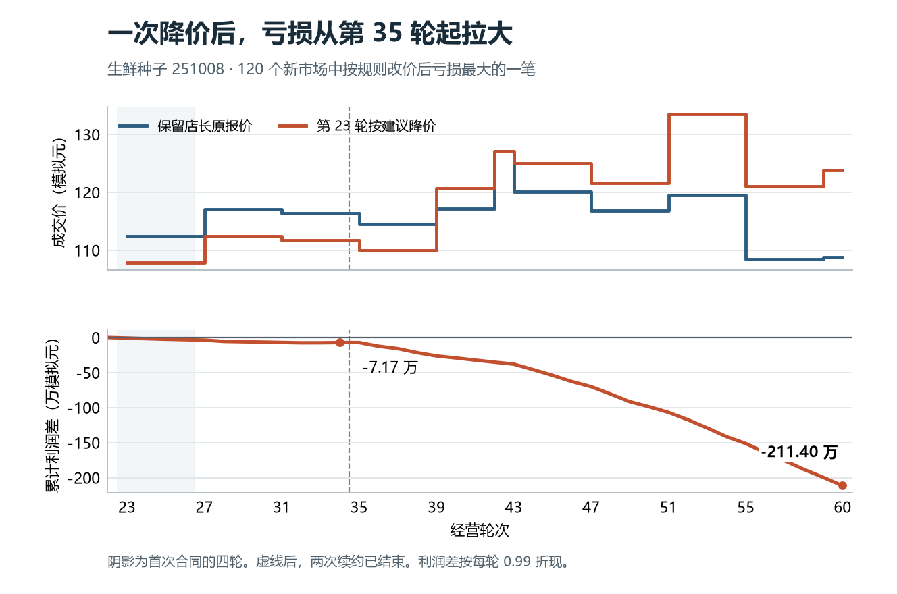
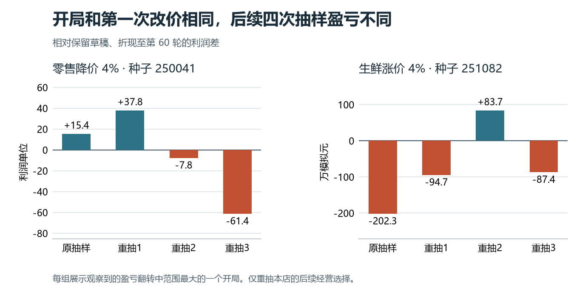

# 公开报价能帮助 AI 店长在什么时候改价？

研究总报告 · 2026 年 11 月 19 日 · 仓库中的模拟市场、真实本地模型及逐轮结算

## 摘要

在四店零售仿真里，公开报价建议在两个独立样本中都提高了平均利润。360 个新市场中，每次预定机会平均多赚 10.26 个零售利润单位，实际改价 81 次，77 次赚、4 次亏。观测亏损率为 4.9%，统计上界为 13.3%，高于预定的 10%。生鲜的单次试价在新市场里也有平均收益，其中一笔少赚 211.40 万模拟元。系统当前将风险估值和候选动作显示给店长，默认执行店长草稿。[新市场及精度复验](renewal-risk.md)

显式预测对手报价能提高预测精度，现有实验尚未确认它能在同样的候选动作和计算预算下稳定选到更赚钱的价格。安装比例同样影响结果。在生鲜持续安装的一个试验中，安装店从一家增加到四家，原先那家店的平均增益下降了 17.22 万模拟元。另一个单装复验没能重现早期增收。[损失归因](price-causes.md) · [四店轮换安装](price-guard.md)

**给一笔报价多跑几条续局，能更准确地估计这笔报价。** 但拿同样的训练量去学习怎样为新开局选价，多续局组在两个市场和两个经营模型上的利润优势均未确认。即使考虑缓存节省，用近似相同的实际模型调用数比较，结论也相同。最直接的例子是生鲜种子 251082。同样涨价 4%，四个续局的终局损益范围从 −202.25 万到 +83.65 万模拟元。这让“某一个开局的涨价效果”有了明确的复算范围。[相同开局的四条续局](#同一个开局能给出几种相反结果)

## 一、研究问题与系统操作

先让经营模型独立出价。建议器接收此前的公开挂牌、当期时点及本店已经给出的草稿。每个预定机会比较保留草稿、降 4%、涨 4%，改价生效四轮。市场约束决定最终执行价。到期后各店继续根据各自已发生的销量和利润报价。保持、降价和涨价三条路径共享市场种子，在同一开局分别运行到第 60 轮。

实验记录所有候选的终局结果。因此可以同时回答两件事。执行建议产生多少利润差，拒绝建议会避开多少损失或错过多少利润。经营模型在每个世界里只读取其所在路径的信息，建议器按价格结算前的输入评分。新研究还在当轮结算前把建议写入归档。可运行公开风险预检查看一笔报价，无需启用推理服务。[操作例与复算命令](renewal-risk.md#如何预检一份报价) · [报价和合同设计](../experiment-specs/renewal-risk-v1/PLAN.md)

## 二、统一结果表

每行采用自己的比较单位和分母。第一组为 300 轮整局利润，持续安装组为每家安装店的终局利润差，单次改价组为每个预定机会的四轮报价合同所带来的终局利润差。生鲜为模拟元，零售和预约各用自身的利润单位，各行金额不相加。方括号为对应实验的配对区间。旧基准使用 95%，后阶段采用 97.5% 种子配对区间。

| 阶段 | 问题与可比较的两组 | 结果 | 对结论的限制 |
|---|---|---|---|
| EconEvals 工程复现 | 用原始运行器复核六条 100 轮报价轨迹 | 600 轮逐轮利润差全部为零 | 覆盖指定难度和种子，原论文完整模型性能表另有范围。[复现记录](econevals-pricing-stage.md#1-外部基准复现) |
| 双寡头持续决策 | 显式对手建模 D 对同预算无条件 C，再对简单规则 B | D−C 为 −37.78 [−80.73, −3.19]。D−B 为 −402.86 [−552.63, −273.36] | 48 个共同种子 × 四种脚本对手。两种搜索的收益包含各自校准筛选。[四组实验](econevals-pricing-stage.md#3-主实验风险与消融) |
| 四店持续安装 | 轮换哪家安装。0、1、2、4 家与同店保留草稿对照 | 两批共 108 个生鲜市场。每安装店在一、二、四家安装时分别 +14.91、+9.55、−0.66 万模拟元。单装对同筛选简单估值仅 +2.62 [−2.89, +11.80] 万 | 原样单装在独立 36 局为 −3.56 万，区间跨零。多店互动与单次改价分别解释。[持续安装复验](price-guard.md) |
| 只改一份合同 | 生鲜 120 个新市场。续约风险规则对店长草稿 | +15.42 [4.65, 26.14] 万模拟元。23/75 次实际改价亏损。最差 −211.40 万 | 同预算直接估值平均少赚 3.64 万，但固定出手数量后优势未确认。[生鲜主验证](renewal-risk.md#新市场主结果) |
| 只改一份合同 | 零售 120 个新市场。相同续约风险规则对草稿 | +10.56 [6.02, 15.50]。3/35 次实际改价亏损 | 相比同预算直接估值少赚 18.32。两策略出手频率不同。[零售主验证](renewal-risk.md#零售) |
| 独立精度复验 | 锁定相同零售策略，另跑 360 个新市场 | +10.26 [7.50, 13.26]。4/81 次实际改价亏损。风险上界 13.3% | 利润下界与覆盖通过，风险未达 10%。[独立补样](renewal-risk.md#独立零售确认与后期亏损否决) |
| 独立数字报价复验 | 另一个旧版策略，直接报数字，256 个新零售种子 | +2.14 [−19.70, 17.63]。5/128 次放行亏损，风险上界 9.67% | 通过频率门槛，收益下界未过。5 笔亏损抵消了约 88% 的 123 笔盈利金额。[独立数字报价](independent-deployment.md) |

## 三、为什么预测更准，企业仍可能少赚

四家店使用相同模型与性格时，仍可独立抽样。在固定提示的 256 次测试中，温度 0 始终选同一档。温度 0.85 覆盖九档，四份独立回复两两同档率为 15.63%。另一个四店试验中，生鲜同时在营的两店完全同价从零安装时的 0.37% 升至全安装的 2.22%，同版平均价格高 12.57%。其他市场的同价变化更小。限价、库存和市场反馈仍会使独立报价偶尔汇到同一个落地价。正面结果受市场、安装规则和报价接口影响，留出的人格、混合人格及预约服务未给出稳定的部署证据。[报价同质化与人格留出](four-prices.md#四家是否越来越像)

在两个市场中逐家预报对手新报价，误差都比沿用上一次略低。在那批三个候选动作的对照中，换成下一轮的真实对手报价，选价也没有改变，额外利润为零。另有同一个对手中位价、不同三家报价的例子，最赚钱动作从降价变成涨价。这证明压缩数据会丢信息，同时也提供了检验新增信息能否转化成行动的反事实。[对手信息的边际价值](price-causes.md)

大亏常在初次合同和下两次续约以后才出现。生鲜最差放行案例头 12 轮少赚 7.17 万模拟元，此后少赚 204.23 万。两条路径的店都活到终局，初次降价后的头两次续约方向也大致估对了。专门预警后期亏损的规则在额外 288 个预留机会中撤掉 15 笔原建议，15 笔原本都会盈利，保留下来的 3 笔亏损一笔也没减少。这次追试直接否决了该筛选层。[逐轮亏损](renewal-risk.md#少数大亏是怎样累积的) · [前瞻筛选对照](renewal-risk.md#预警晚期损失能否少错几个)

## 四、同预算多跑续局的新检验

### 用同样的训练量，多看开局还是重复同一个开局

在上一阶段基础的 120 个市场之上，两种方法各增加 96 份三臂终局。宽覆盖读 96 个开局各一次，多续局读 24 个开局各四次。两组用同样的 96 棵树和公开特征评估涨降两个动作。原开局和四轮合同完全固定，重抽只替换本店下一次续约后的经营模型抽样种子。先冻结模型和风险线。逐份写下只看公开信息的预测后再打开终局损益。评分时两种方法的补充训练材料都已归档，新报价各需零次经营模型调用。

| 市场 | 96 个开局各一次的实际请求数 | 24 个开局各四次的实际请求数 | 调整到近似相同请求数时，宽覆盖能做多少开局 |
|---|---:|---:|---:|
| 零售 | 6,608 | 2,830 | 41 个，2,824 次请求 |
| 生鲜 | 5,845 | 2,446 | 40 个，2,423 次请求 |

共享开局使多续局组复用此前的请求。在相同三臂终局标签数与近似相同的实际请求数下，分别比较经济收益。两种预算结果均衡量追加训练材料，共用的 120 个基础开局未重复计费。新样本按较低预测风险取同样数量的候选，考虑限价后另报实际成交改价次数。另一套分数线仅用旧历史样本冻结，可以逐笔运行。

| 留出市场（各 48 局） | 相同出手数的建议 | 多续局减宽覆盖，相同终局数 | 多续局减宽覆盖，近似相同请求数 | 亏损概率评分差，多续局减宽覆盖 |
|---|---:|---:|---:|---:|
| SmolLM2 零售 | 12 | -1.51 [-15.41, +11.00] | -2.00 [-15.01, +10.40] | -0.0053 / -0.0174 / +0.0071 |
| SmolLM2 生鲜 | 11 | +0.49 [-3.88, +4.30] | -0.76 [-5.73, +3.24] | -0.0064 / -0.0288 / +0.0138 |
| Qwen 零售 | 12 | +0.72 [-1.16, +2.60] | -0.02 [-1.21, +0.84] | -0.0134 / -0.0287 / -0.0003 |

生鲜的利润差以万模拟元计。零售用基准利润单位。概率评分取实际生效的两方向观察，负值代表多续局的误差更小。建议数固定排序是诊断结果，实际逐笔策略用冻结分数线。

| 留出市场 | 冻结宽覆盖，相对草稿 | 宽覆盖亏损 / 改价 | 冻结多续局，相对草稿 | 多续局亏损 / 改价 | 先前冻结的续约规则，相对草稿 |
|---|---:|---:|---:|---:|---:|
| SmolLM2 零售 | +22.38 [+10.24, +37.76] | 1/17 | +13.23 [+4.96, +24.16] | 1/12 | +20.61 [+6.97, +38.46] |
| SmolLM2 生鲜 | +4.67 [-1.18, +14.70] | 6/10 | +5.16 [-0.28, +14.59] | 5/10 | +13.50 [+4.89, +24.54] |
| Qwen 零售 | +2.39 [-0.33, +5.37] | 5/17 | +3.50 [+0.97, +6.49] | 2/16 | +3.49 [+0.21, +7.13] |

两种预算下，多续局相对宽覆盖的利润差区间均含零。复制首条结果作对照后，也没有测到新随机续局带来确定的额外利润。Qwen 组的亏损概率评分改善 0.0134，利润优势仍未确认。固定降价的平均收益在同样 48 个零售种子上从 SmolLM2 的 +38.61 降至 Qwen 的 +5.10。前一阶段锁定的续约建议规则也从 +20.61 降至 +3.49，配对差 −17.12 [−33.55, −4.32]。动作空间、种子和合同相同，换经营模型已经足以改变可获得的增量。Qwen 自己曾用于较早实验，它的本批轨迹没有参与本次训练或阈值选择。这两组每组 48 局，用于比较迁移效果，原先大样本风险验证仍单独保留。

### 同一个开局能给出几种相反结果

每个市场预抽 24 个开局，每个重抽三次，并保留原运行。仍能改到执行价的开局参与以下统计。方差比例估计的是在这些开局内只重抽本店造成的波动占比，开局之间还包含市场状态、时点等差异。误差按同一个开局的前几条结果预测另一条结果计算，两种方法使用对称留一比较。它检验重复标签的局部价值，训练模型对新开局的表现由上表检验。

| 市场与方向 | 一共能实际改价的开局 | 有正也有负的开局 | 同开局后续抽样的方差占比 | 同开局用三条估计，比用一条的绝对误差变化 |
|---|---:|---:|---:|---:|
| 零售降价 | 24 | 7 | 45.6% [30.4%, 66.4%] | -4.57 [-6.50, -2.97] |
| 零售涨价 | 24 | 6 | 50.3% [24.7%, 72.7%] | -4.09 [-6.35, -2.42] |
| 生鲜降价 | 19 | 9 | 43.6% [30.2%, 83.4%] | -4.99 [-7.71, -2.58] |
| 生鲜涨价 | 19 | 7 | 81.5% [43.7%, 100.0%] | -5.98 [-11.39, -2.25] |

上图展示每组盈亏翻转中幅度最大的开局。48 个重复开局及它们的分支只用于训练和波动诊断，外部效果以新市场衡量。Qwen 零售复用了同一批市场种子，因此两模型的比较有 48 个配对单位。每市场另有 96 个旧独立市场的回顾性对照和重复原标签的控制，均可从数据文件查阅。

[冻结方案](../experiment-specs/distribution-v1/PLAN.md) · [预算与数据哈希](../experiment-results/distribution-v1/freeze.json) · [全量结果和逐模型配对](../experiment-results/distribution-v1/results.json)

## 五、可以发表什么

EconEvals 提供可核对的经济决策环境和评分。Fish、Gonczarowski 与 Shorrer 已经验证 LLM 卖家在特定寡头设置中可以很快产生高于竞争基准的价格，提示写法会改变程度。我们的四店数据中，一家和四家用同一建议器时的结果有差别，未把价格相近单独当作合谋证据。B2B 定价建议及逐案例选择人与模型也有现场前作，Karlinsky-Shichor 与 Netzer 报告其试验中被处理报价的利润提高 11%。[EconEvals](https://arxiv.org/html/2503.18825v4) · [Algorithmic Collusion by Large Language Models](https://arxiv.org/abs/2404.00806) · [Automating the B2B Salesperson Pricing Decisions](https://business.columbia.edu/faculty/research/automating-b2b-salesperson-pricing-decisions-human-machine-hybrid-approach)

本项目的论文贡献可以表述为一次可复算的竞争定价干预测量。对同一份原方案结算涨、降、保持，测量公开信息带来的增量收益、尾损和错拒成本，检验继续经营和安装比例怎样改变结论。论文可以报告何时平均收益成立、为何低风险验收失败、预测更准何时没有转化成经营价值。已有外部与原生市场、源码复现、真实模型报价和相同预算基线支持计算实验论文。作者能声明的利润范围是已测模拟机制。现实企业利润还需要真实交易、企业自主采纳及竞争市场的随机化或其他可识别设计。[相关工作与贡献定位](publication-related-work.md) · [企业现场验证设计](field-validation.md)

## 六、交付与验收

自动调价晋级沿用阶段原线。独立测试的利润区间下界须超过零售 5 个利润单位或生鲜 2 万模拟元，实际改价覆盖至少 10%，亏损率的单侧 98.75% 上界至多 10%。这些条件一起决定是否从风险预览进入自动执行。先验阈值、样本标签、每个建议当时能看到的价格及终局利润均留有可复算记录。

对团队的操作建议是先拿宽覆盖做选择器的对照，保留重复续局用来估计单笔大亏和复核高风险候选。评估时同时记下每次机会净收益、出手次数、亏损概率和每次亏损的金额。跨模型和多店安装各自独立验收。

本轮增加 96 个新市场种子。在 48 个相同零售种子上又换 Qwen 完整运行，另新增 72 条随机序列的续局。每个市场或续局均有三条完整价格分支，共 648 条新终局路径，主要实验产生 11,074 份新本地模型回包。CPU 项目模型服务均已退出。新增商业 API 费用为 0 元。累计台账余 0.155084 元。569 项项目测试通过，另有一条旧依赖弃用提示。独立 Git 检出完成离线复算，重新生成的评分、结果和图表与归档一致。[新实验复算](../experiment-specs/distribution-v1/REPRODUCE.md) · [设备和调用记录](../experiment-results/distribution-v1/runtime.json)
