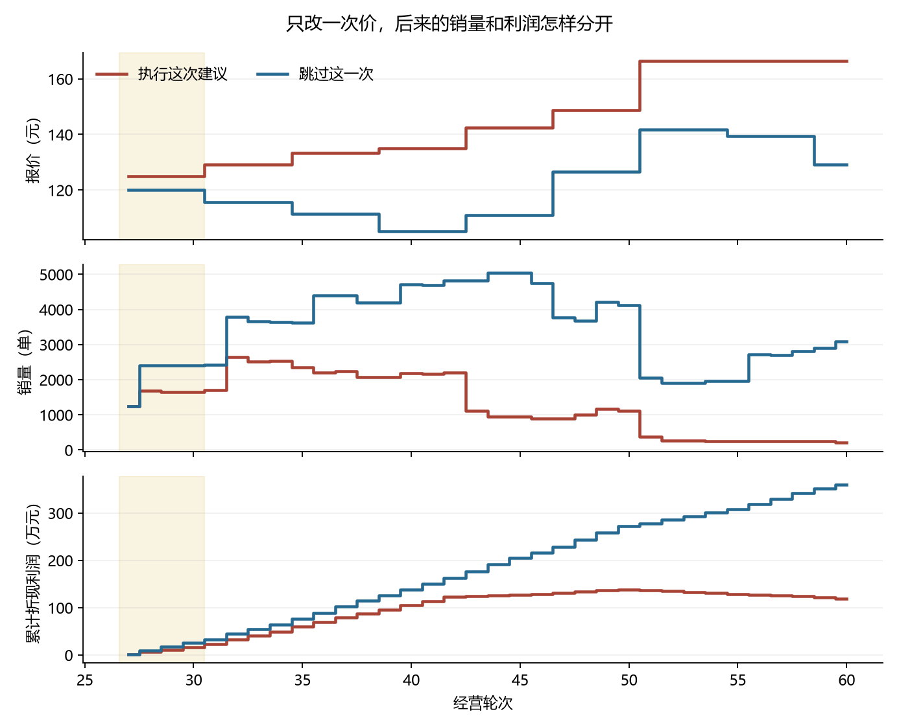

# 四家店都装定价助手，会赚还是会亏？

**这版助手没有通过自动改价验收。** 在九档独立报价的生鲜市场，只给一家装，这家平均比让店长自己报价少赚 65.54 万模拟元；四家都装，每家仍少赚 34.55 万。外部零售市场从单家受损变为四家全装时平均多赚 42.01，简单估值助手在同条件下也多赚 42.34。

每张表都与同一个新市场、同一家店保留经营模型原报价相比。每局60轮，四家从第7轮起自己报数字档位，第19轮起才可以接受助手改价，一次管4轮。0家安装表示每次都让店长自己报价，利润差定义为零。安装指助手决定改价时自动执行；没有把安装等同于真人主动采纳。本文头条使用全部360个市场逐次调用本地真实模型的结果。

## 一家、两家和四家分别赚了多少

| 市场 | 0家 | 1家安装 | 2家安装，每家 | 4家安装，每家 | 4家中仍是原先那家店，相对它单独安装 |
|---|---:|---:|---:|---:|---:|
| 生鲜（万模拟元） | 0 | −65.54 [−87.00, −44.77] | −62.64 [−75.78, −50.13] | −34.55 [−42.49, −26.95] | +39.19 [+24.30, +56.05] |
| 零售基准（利润单位） | 0 | −108.29 [−127.72, −89.13] | −77.80 [−91.20, −64.60] | +42.01 [+30.73, +52.49] | +149.61 [+128.05, +170.31] |
| 预约服务（利润单位） | 0 | −61.67 [−82.28, −41.55] | −22.87 [−38.20, −7.77] | +24.45 [+10.52, +38.58] | +75.94 [+54.91, +97.66] |

数字是从首次可能调价起到第60轮的累计利润差，未来每轮折现1%。方括号为市场种子配对自举的1.25%和98.75%界。单家和两家列均只平均装了的店；不同市场的模拟利润单位不能混加。每个12种子块轮遍四个单店位置和六个双店组合。另在18个相同市场里穷举全部安装身份，消除换种子影响。

| 同市场穷举，每个市场/人格组取首末种子 | 单店安装，四位置等权 | 两店安装，六组合等权 | 同一局换单店安装者，最大收益跨度 |
|---|---:|---:|---:|
| 生鲜（万模拟元） | −66.63 | −63.72 | +392.76 |
| 零售基准（利润单位） | −93.31 | −54.38 | +407.52 |
| 预约服务（利润单位） | −67.32 | −39.97 | +172.42 |

## 简单估值和未安装的竞争者

| 市场 | 安装数 | 简单估值相对原价 | 对手建模相对简单估值 | 没装的竞争者平均变化 |
|---|---:|---:|---:|---:|
| 生鲜（万模拟元） | 1 | −71.17 [−92.24, −50.41] | +5.64 [+1.03, +11.86] | +20.73 [+14.22, +26.98] |
| 生鲜（万模拟元） | 2 | −65.37 [−79.31, −52.59] | +2.73 [−1.05, +7.07] | +55.71 [+46.51, +65.17] |
| 生鲜（万模拟元） | 4 | −35.18 [−42.89, −27.53] | +0.63 [−2.01, +3.25] | 无未装店 |
| 零售基准（利润单位） | 1 | −98.16 [−117.86, −78.94] | −10.13 [−19.34, −0.99] | +45.58 [+37.26, +53.61] |
| 零售基准（利润单位） | 2 | −68.44 [−80.62, −56.35] | −9.36 [−16.24, −2.87] | +115.35 [+101.06, +129.61] |
| 零售基准（利润单位） | 4 | +42.34 [+32.14, +52.64] | −0.33 [−4.44, +3.28] | 无未装店 |
| 预约服务（利润单位） | 1 | −53.57 [−71.98, −35.20] | −8.10 [−16.28, −0.80] | +18.26 [+10.54, +27.27] |
| 预约服务（利润单位） | 2 | −13.18 [−27.16, +1.07] | −9.69 [−19.46, −0.87] | +41.08 [+29.84, +52.18] |
| 预约服务（利润单位） | 4 | +29.15 [+15.91, +43.36] | −4.70 [−10.43, +1.30] | 无未装店 |

两种复核器都看历史公开报价、待复核的本企业草稿和轮次；面对三位竞争者，统一使用在营对手历史中位报价。每次都计算原冻结模型与直接估值模型，共用同一组保留、降4%、涨4%候选。所有店先同时提交报价，随后才统一结算。

## 四家是否越来越像

| 市场 | 0家两两同价 | 1家 | 2家 | 4家 | 4家相对0家市场均价 |
|---|---:|---:|---:|---:|---:|
| 生鲜（万模拟元） | 0.37% | 0.30% | 0.36% | 2.22% | 12.57% |
| 零售基准（利润单位） | 0.65% | 0.62% | 0.60% | 0.70% | 7.97% |
| 预约服务（利润单位） | 0.74% | 0.51% | 0.75% | 0.53% | 8.15% |

同价比例只计同轮两家都在营的比较。只看完全相同的报价会漏掉价格虽不同但已靠近的情况。各覆盖组的两两绝对价差和配对区间见 subgroups.json。外部市场全装的消费者剩余变化为 −414.59 [−448.78, −379.13]；生鲜为 −307.16 [−328.15, −286.46] 万模拟元。预约市场无经容量修正的消费者剩余估计。价格接近本身不能证明企业存在协议或主动合谋。

旧四店实验采样温度为0。本轮用同一个提示、同一模型、同样的人格，分别实际生成256次：旧设置256次都选同一档；温度0.85时九档均出现，四个独立抽样一组，两两同档15.63%。系统没有强迫错开报价。新的四店实验入口及新注册的真实经营版本默认使用0.85，仍可显式设0复算旧协议。

## 去掉九档限制，让四位店长直接报数字

| 新种子，每市场12局 | 0家同价率 | 1家利润差 | 2家每店利润差 | 4家每店利润差 | 4家同价率 | 真实原始数值种类 / 独立请求 |
|---|---:|---:|---:|---:|---:|---:|
| 零售基准（利润单位） | 42.79% | −6.20 [−135.16, +135.29] | +71.84 [+3.31, +142.58] | +27.42 [−16.37, +83.28] | 41.93% | 592 / 1,711 |
| 生鲜（万模拟元） | 22.38% | +32.05 [+4.31, +66.13] | +4.70 [−5.90, +17.27] | +3.85 [−10.51, +14.14] | 20.79% | 480 / 925 |

在这批新种子上，生鲜单店从主试验的平均少赚65.54万，变为平均多赚32.05万模拟元 [4.31万, 66.13万]；全装为每家多赚3.85万 [−10.51万, 14.15万]。经营者的原报价接口足以改变问题的实际答案。12个市场不足以确认罕见损失；不能用单店这一个正结果宣布部署。零安装下48家生鲜企业到期末仅15家在营，全装为17家。12个种子中仅8个在观测期间还能比较两家在营企业的价格。同价率排除无可比对手的局，利润保留全部12局。

这一批真实模型不选菜单，直接输入非负价格（最多三位小数），并看到最近四轮的实际价格、销量和利润。外部有 882 个申请超出当时区间，生鲜有 429 个，均按同一合法边界裁剪。全部24局、七种政策都到第60轮，用来检验接口敏感性。样本较小，不能把两种接口合并推断。模型经营者的价格自由度和可见数字精度同时变化。

为什么独立随机以后，仍然会同价？零安装时逐轮追溯原始模型输出：外部市场有1,294个同价的企业对/轮，其中1,170个原本报了不同数字；生鲜161个同价对/轮中有129个原始数字不同。市场合法边界、货币精度以及持价合同把不同申请压到了同一执行价。这个计数按实际企业对/轮累计，上表的同价率则按市场等权。独立模型抽样和最终成交报价是两件可分别核验的事。[原始与执行报价碰撞统计](../experiment-results/four-prices-v1/open-price/collisions.json)

## 陌生人格与随机人格

| 市场 | 四家性格 | 1家装 | 4家全装 |
|---|---:|---:|---:|
| 生鲜（万模拟元） | 均衡 | −85.01 [−120.74, −50.72] | −41.48 [−55.89, −27.66] |
| 生鲜（万模拟元） | 完全留出的现金缓冲型 | −51.98 [−89.66, −16.68] | −33.64 [−46.89, −20.92] |
| 生鲜（万模拟元） | 四店各自独立抽取 | −59.62 [−91.31, −31.53] | −28.52 [−41.20, −16.41] |
| 零售基准（利润单位） | 均衡 | −105.95 [−143.56, −67.18] | +42.30 [+21.70, +61.71] |
| 零售基准（利润单位） | 完全留出的现金缓冲型 | −109.37 [−139.84, −80.09] | +41.17 [+21.05, +59.33] |
| 零售基准（利润单位） | 四店各自独立抽取 | −109.55 [−141.16, −76.46] | +42.56 [+24.04, +62.12] |
| 预约服务（利润单位） | 均衡 | −58.27 [−92.66, −24.93] | +13.71 [−11.22, +38.82] |
| 预约服务（利润单位） | 完全留出的现金缓冲型 | −57.46 [−96.96, −22.93] | +35.40 [+10.76, +58.62] |
| 预约服务（利润单位） | 四店各自独立抽取 | −69.28 [−109.16, −38.17] | +24.23 [+2.15, +46.39] |

人格改变店长收到的经营指令。建议器从未收到人格标签、现金、销量或私人目标，也没有用本批结果重新训练。随机组每家开局从四种指令独立抽取并固定整局；公平标准是按用户目标衡量已实现利润，不把扮演指令的文字相似度算作应对正确。按被安装店实际人格展开的样本量与效果见 subgroups.json。此处只验证一份真实权重与四种提示人格。

## 最差会亏多少，怎么亏的

| 市场 | 安装数 | 最差一家店 | 最差5%市场中已装店的平均差额 | 安装店平均亏于基线的局数 |
|---|---:|---:|---:|---:|
| 生鲜（万模拟元） | 1 | −406.85 | −327.89 | 102/144 |
| 生鲜（万模拟元） | 2 | −565.40 | −233.58 | 117/144 |
| 生鲜（万模拟元） | 4 | −566.37 | −121.66 | 112/144 |
| 零售基准（利润单位） | 1 | −428.27 | −341.62 | 132/144 |
| 零售基准（利润单位） | 2 | −598.81 | −228.40 | 127/144 |
| 零售基准（利润单位） | 4 | −414.88 | −90.59 | 34/144 |
| 预约服务（利润单位） | 1 | −334.91 | −259.02 | 57/72 |
| 预约服务（利润单位） | 2 | −216.32 | −134.49 | 42/72 |
| 预约服务（利润单位） | 4 | −292.11 | −88.47 | 23/72 |

生鲜四家全装时，预抽的单次合同中最大损失出现在种子 181081、第 27 轮、店 A。在相同历史上只撤掉这一次建议，其余店当期照常，之后全部经营者继续运行。执行这次建议到终局相对少赚 240.88 万模拟元；前四轮差额 −8.62 万，随后差额 −232.26 万。

| 轮次 | 听这次建议的实售价 / 销量 | 只跳过这次的实售价 / 销量 |
|---|---:|---:|
| 27 | 124.92 元 / 1,243 单 | 120.11 元 / 1,243 单 |
| 31 | 129.09 元 / 1,702 单 | 115.72 元 / 2,429 单 |
| 35 | 133.39 元 / 2,348 单 | 111.49 元 / 3,631 单 |
| 39 | 134.97 元 / 2,065 单 | 105.18 元 / 4,192 单 |

按实际账本拆开，这个案例的售价变化贡献 +78.02 万，销量变化贡献 −724.42 万，成本变化贡献 +405.52 万。报价更高使卖出的每单更值钱，流失的订单改变了总结果。对照轨迹中的其它决定允许随新的市场反馈变化。

另对每个市场各覆盖组的最差单店，分别撤去其十次合同之一，重新跑到终局；又将其他三店的申请价逐轮固定为它们在零安装市场中的报价。下表是生鲜三例。各合同撤回效应相互作用，不能相加。

| 安装数 | 整局最差店差额（万） | 对手固定零安装报价时（万） | 只跳过哪一轮帮助最大 | 这一轮对终局的贡献（万） | 对手因市场约束未复原的报价次数 |
|---|---:|---:|---:|---:|---:|
| 1 | −406.85 | −404.76 | 19 | −122.46 | 43 |
| 2 | −565.40 | −557.46 | 19 | −149.34 | 21 |
| 4 | −566.37 | −531.25 | 23 | −372.73 | 10 |

全装生鲜的所有预定企业合同中，首轮实际涨价 2,989 次、降价 349 次，其余 2,422 次保持原价、退出或受限。预抽后确实造成亏损的 69 次改价中，有 66 次的销量减少拉低了收入；有 15 次在前四轮多赚，之后仍转为终局亏损。这些计数覆盖全部审计案例。

## 按原门槛验收

| 只给一家一次机会 | 全部预定机会平均利润增量 | 实际调价 / 机会 | 调价中亏损 | 亏损率单侧上界 | 是否过关 |
|---|---:|---:|---:|---:|---:|
| 生鲜（万模拟元） | −11.34 [−20.56, −3.27] | 97/144 | 62 | 74.63% | 未通过 |
| 零售基准（利润单位） | −19.22 [−28.80, −10.28] | 81/144 | 64 | 88.22% | 未通过 |
| 预约服务（利润单位） | −6.47 [−14.01, −0.46] | 34/72 | 20 | 77.27% | 未通过 |

原规约要求外部利润下界高于5，生鲜高于2万模拟元，实际放行比例至少10%，亏损率的单侧98.75%上界不超过10%。持续安装另以每家十次预定机会为分母，并对随机选定的公司/合同做单次撤回审计。所有市场和安装比例均未通过联合门槛。预约场景仅用+5作参照。

## 适用范围、运行与验收

生鲜直接使用项目供应、缺货、定价限制、经营成本和退市规则。EconEvals 使用作者的需求、利润函数及四家独立定价扩展。预约服务加入每期有限时段、卖不掉也要承担的成本和无位流失，直接移植零售模型。它给出了同属竞争性定价的一次迁移结果；没有测试采购、广告、人事分配、真实商户或任意博弈。

全部360个新种子，生鲜和零售各144个，预约72个。全量真实后端组有 43,078 个不同的经营请求，跨分支完全相同的公司、日期、提示及随机种子复用真实回包。模型为本地 SmolLM2-1.7B-Instruct Q4_K_M；草稿是围绕反馈参考价的九个数值档。每轮经营至第60轮，未调参。已离线核对 4,680 条主/对照/诊断终局轨迹及18个完整市场的逐步重放。

独立后端估值的市场样本上，现金缓冲型和随机性格组在生鲜全装分别少赚33.64万、28.52万模拟元。真实工具没有通过原门槛。实际修复方向是将销量下滑、退市风险和后续轮次的损失金额纳入是否改价的判断；新规则需要另用新种子验证。

原限定概率表的实验也完整保存。推理服务在不同批次返回的单档概率与固定表有数值差异，因此又用全部原种子进行直接解码。108个原服务端市场复用，不把两批相加或视作两次独立复验。两种执行口径的均值可直接比较。

| 市场 | 原混合执行，一家 / 四家 | 全量直接解码，一家 / 四家 |
|---|---:|---:|
| 生鲜（万模拟元） | −69.77 / −38.67 | −65.54 / −34.55 |
| 零售基准（利润单位） | −113.81 / +43.15 | −108.29 / +42.01 |
| 预约服务（利润单位） | −59.41 / +17.33 | −61.67 / +24.45 |

本轮商业支出0元。累计台账49.844916元，原50元余额0.155084元，未计本机电费，未与供应商账单核对。结果是固定模拟市场内的利润。冻结后的运行规约、回放说明与全部原始轨迹随仓库发布。

[冻结方案](../experiment-specs/four-prices-v1/PLAN.md) · [全量后端复算说明](../experiment-specs/four-prices-v1/FULL-LIVE.md) · [运行命令](../experiment-specs/four-prices-v1/REPRODUCE.md) · [全部对照](../experiment-results/four-prices-v1/live/summary.json) · [逐次撤回结果](../experiment-results/four-prices-v1/live/tail-replay.json)
