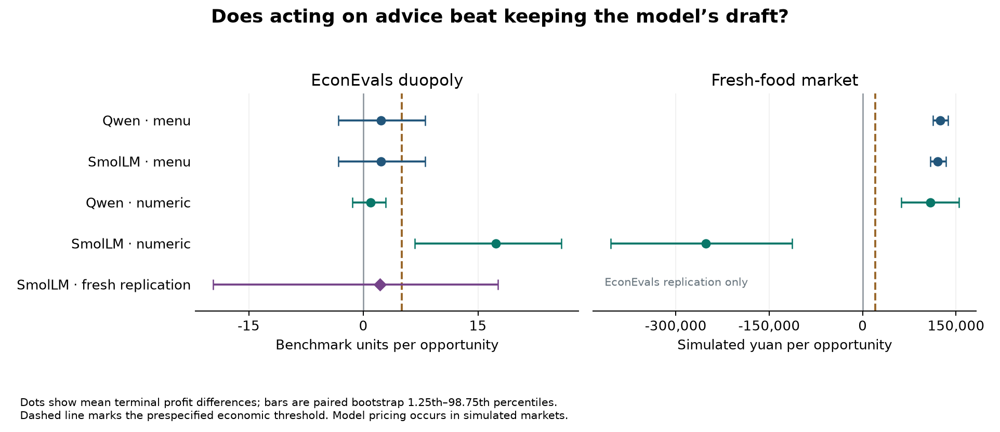

# 企业应不应该改掉真实模型的报价？

**冻结的建议器能筛出部分坏调价，但目前没有一项独立复验同时确认了最低利润、覆盖和风险。** 最有希望的组合在 256 个新种子中放行 128 次，123 次赚钱，5 次亏损。赚钱时平均赚 38.62，亏损时平均损失 840.33，摊到每个预定机会只多赚 2.14 个基准单位，区间跨零。隐藏切换时点后，等待四轮搜集更多信息也没有稳定超过立即决定。两份未参与开发的模型真实推理，交易和利润在模拟市场结算。用户确认暂无已授权现场数据，真实企业净利润效应仍未测量。

## 事前可以被否决的部署标准

焦点企业已经给出了可执行原草稿。预定机会保留、申请涨 4%、申请降 4%，各维持四轮，随后恢复各自路径上的模型决策到第 60 轮。建议层只读双方过去的公开报价、当前草稿、轮次；经营模型可以读取自身已结算经营反馈。保留草稿、同预算无条件先验、同容量直接价值模型、固定涨跌都是对照。经营目标是该企业累计利润，和市场价格水平或社会福利不同。

部署要求沿用上阶段功效示例并在本轮确认前锁定。EconEvals 每个预定机会要求比保留多赚 5 个基准利润单位，生鲜要求多赚 20,000 模拟元。还要求至少覆盖 10% 机会、放行亏损概率的单侧上界不超过 10%。利润包括放弃干预得到的零增量。四项主比较分别用种子配对自举的 98.75% 单侧下界检验最低收益，并给出上界以判断能否排除该幅度。下文方括号为 1.25%–98.75% 自举分位数，普通 95% 区间及未折现口径另列在机器结果中。经济门槛是研究假设，尚未经企业确认。[主设计](../experiment-specs/independent-deployment-v1/PLAN.md)

原试点配对差标准差为 19.29 和 432,134。假设真实收益比门槛再高一个门槛，在给定标准差、双模型双市场单侧家族 5%、80% 功效的正态近似下，每模型分别需要 142 和 4,438 个种子。主确认实际每模型用 192 和 4,608 个，共 9,600 个“模型 × 市场 × 种子”机会。同一市场两个模型共享种子，各自独立分析。统计单位是独立市场种子；两份权重不能代表两个独立抽取的模型家族总体。确认数据不回流到建议器训练。

## 两种报价接口

**三档原草稿。** Qwen2.5-0.5B-Instruct 与 SmolLM2-1.7B-Instruct 使用官方 GGUF 量化权重、固定版本和真实贪心解码。经营模型每个合同选择相对反馈价下调、维持原价或上调 4%。输入的市场类别、剩余时长、相对报价、销量和利润趋势均已离散化。每份权重的全部 162 种提示各真实推理一次；逐轮根据本分支实际状态查找字节相同的请求。Qwen 在 162 种提示中均选择上调；SmolLM 在 161 种中上调，另一次下调。基础反馈价仍随本企业的历史变化。样本增加能精确估计这种经营政策的效果，不能消除菜单造成的行为单一问题。[Qwen 权重](https://huggingface.co/Qwen/Qwen2.5-0.5B-Instruct-GGUF/tree/9217f5db79a29953eb74d5343926648285ec7e67) · [SmolLM 权重](https://huggingface.co/HuggingFaceTB/SmolLM2-1.7B-Instruct-GGUF/tree/2d4a76a30b4af41ecd395c35725ac11688d4cfe4)

交换 A 与 C 的涨跌含义，保持相同的 162 个观测，再对每个模型运行全部提示。Qwen 162 次均保持原字母，实际调价方向全部翻转；SmolLM 在 83/162 个情境保持原方向。菜单经营利润受选项编码影响，尤其不能将该菜单表现解释为 Qwen 对涨价的稳定经济偏好。[菜单互换结果](../experiment-results/independent-deployment-v1/menu-reversal.json)

**直接数值原草稿。** 检查完菜单输出后，补充锁定两个市场各 192 个新种子，每个种子由两个模型各运行一次，共 768 个新机会。提示含最近四轮真实的双方价格、己方销量与利润、当期合法区间、参考价和剩余轮数。模型能直接提出最多三位小数的任意非负报价，市场裁剪越界数值；所有已完成样本计入。每条分支后续合同仍由同一个经营模型根据分支自己的数字重新报价。商业 API 未参与这两项检验；此前的 DeepSeek 和豆包结果保留为单独资料。直接数值组的生鲜样本不满足原先按高方差情景规划的 4,438 个种子，其区间单独解释。[数值报价冻结方案](../experiment-specs/independent-deployment-v1/NUMERIC.md)

## 改掉原报价的终局利润

每行按全部预定机会取平均。比较列为“使用对手推断的建议器”减去相应对照。放行数按建议器事前决定计，包括执行时受价格边界限制的申请。亏损指该次放行比保留原计划少赚。

| 草稿 | 市场与模型 | 独立种子 | 相对保留，均值 [界限] | 相对同预算均匀先验 | 相对固定降价 4% | 放行中亏损 |
|---|---|---:|---:|---:|---:|---:|
| 三档 | EconEvals · Qwen | 192 | +2.32 [−3.28, +8.08] | +5.45 [+0.66, +10.64] | −67.40 | 23/52 |
| 三档 | EconEvals · SmolLM | 192 | +2.32 [−3.28, +8.08] | +5.45 [+0.66, +10.64] | −67.40 | 23/52 |
| 三档 | 生鲜 · Qwen | 4,608 | +124,846 [+112,765, +137,350] | −479 [−2,292, +1,256] | −84,075 | 1,348/3,439 |
| 三档 | 生鲜 · SmolLM | 4,608 | +120,661 [+108,387, +133,474] | +304 [−1,714, +2,187] | −88,335 | 1,342/3,431 |
| 数值 | EconEvals · Qwen | 192 | +0.97 [−1.42, +2.93] | +0.27 [−0.25, +0.91] | −6.32 | 4/19 |
| 数值 | EconEvals · SmolLM | 192 | +17.33 [+6.74, +25.91] | +0.49 [+0.00, +1.20] | +40.47 | 2/99 |
| 数值 | 生鲜 · Qwen | 192 | +108,389 [+62,282, +154,611] | −1,220 [−11,608, +9,314] | +255,590 | 56/173 |
| 数值 | 生鲜 · SmolLM | 192 | −251,943 [−404,770, −113,254] | +10,535 [+0, +37,963] | +184,702 | 77/152 |

三档生鲜中，Qwen、SmolLM 每个预定机会的额外利润均已超过 20,000 模拟元。但固定降价的利润更高，且两模型的放行亏损率单侧上界分别达到 41.1%、41.0%，高于事前允许的 10%。按全部机会计算，最差 5% 平均分别少赚 503,509、574,465 模拟元。外部市场中，对手推断超过均匀先验 +5.45 [0.66, 10.64]，同时落后于直接估值 −7.49 [−12.75, −2.90]。因此“有时比保留强”“对手信息有边际价值”“能筛走高风险机会”必须分别检验。

**直接报价的营业结果随模型和市场改变。** EconEvals 的 SmolLM 每个机会平均多赚 17.33 [6.74, 25.91]，放行 99/192，其中 2 次亏损，亏损概率上界为 7.95%。它通过了预先规定的三道门槛，最大单次损失仍有 592.58 个利润单位，故低亏损频率与低损失幅度应分别陈述。相同市场的 Qwen 收益上界为 2.93，已排除 +5 的部署幅度。生鲜 Qwen 多赚 108,389 模拟元，但在 173 次放行中有 56 次亏损，风险上界 41.0%；SmolLM 平均少赚 251,943，即便按四类市场变化分层重抽，区间仍完全低于零。在 SmolLM 生鲜最差 5% 的机会中，每个机会平均少赚 2,856,833 模拟元。这是终局模拟经营利润；实现样本中的平均提升和最差企业的损失可以同时很大。

即使在 SmolLM 的正向外部组，使用对手类型与将类型设为等概率相比，每机会只多 0.49 [0.00, 1.20]，两者在 188/192 个机会给出完全相同的行动。直接价值回归与对手推断的差也跨零。四组数值定价用 19,498 个不同的完整推理请求（Qwen 10,358、SmolLM 9,140），实际模型输出包含 1,207 个不同数值。四组在干预轮被市场裁剪的原草稿数分别为 0、22、11、6，分母中保留一切退市和价格受限案例。市场仍在营业的数量分别为 192、192、191、184。[数值报价冻结设计](../experiment-specs/independent-deployment-v1/NUMERIC.md)

**定向独立复验。** 因为只有 SmolLM 的外部数值组通过全部门槛，看到首批结果后，以 Git 提交 `1a0ce14` 锁定该组合、256 个未使用的种子及全部原门槛，冻结算法后重新跑到终局。两批保持分开。复验的平均收益为 **+2.14 [−19.70, +17.63]**，未确认每个机会至少多赚 5；上界仍然允许这一幅度。覆盖 128/256，放行亏损 5/128，单侧风险上界 **9.67%**，两项均达标。放行中赚钱的 123 次平均多赚 38.62，亏损的 5 次平均少赚 840.33，最大单次损失 1,350.77。按全部机会计最差 5% 平均损失 323.21。拒绝的 128 个候选中有 62 个若执行会赚钱、64 个会亏、2 个持平；被拒者的候选均值为 −115.86。结果支持在这一市场与经营模型上事前区分一部分值得拒绝的修改，并揭示即使亏损概率控制在 10%，总利润门槛仍可能无法通过。

复验中，对手推断与均匀先验有 246/256 次采取同一行动。终局相对均匀先验为 −7.16 [−20.96, +0.62]，相对直接估值为 +1.27 [−18.63, +20.60]，相对固定降价为 +48.09 [+1.09, +96.73]，相对固定涨价为 +91.68 [+53.32, +132.90]。可以证实在此复验中有选择地行动超过一律涨价或一律降价，但没有证明需要对手类型推断才能做到。结论按既定规则以独立复验为准。[复验锁定方案](../experiment-specs/independent-deployment-v1/NUMERIC-REPLICATION.md) · [全部复验统计](../experiment-results/independent-deployment-v1/replication-results.json)

**弃权的反事实核查。** 对同一时点先产生最佳涨/跌候选，然后才准许保留。下表将建议器拒绝的候选也结算至第 60 轮，以看清门槛在放行后承担的风险和拒绝后错过的收益。零增量含边界、退出或相同后续回报。

| 数值组 | 放行数 | 放行后赢 / 输 / 平 | 弃权数 | 被拒报价其实能赚钱 | 被拒报价其实会亏损 |
|---|---:|---:|---:|---:|---:|
| EconEvals · Qwen | 19 | 15 / 4 / 0 | 173 | 89 | 84 |
| EconEvals · SmolLM | 99 | 97 / 2 / 0 | 93 | 53 | 39 |
| 生鲜 · Qwen | 173 | 115 / 56 / 2 | 19 | 8 | 11 |
| 生鲜 · SmolLM | 152 | 66 / 77 / 9 | 40 | 7 | 27 |

[三档确认全表](../experiment-results/independent-deployment-v1/independent-results.json) · [数值报价全表](../experiment-results/independent-deployment-v1/numeric-results.json) · [分层区间、可执行调价与弃权审计](../experiment-results/independent-deployment-v1/precision.json)

## 企业不知道何时发生变化

留出阶段每市场 512 个新种子，稳定、需求变化、对手跟随/压价、对手反向各 128 个。变化类型和首次生效轮（8–53）仅供结算器与评估者使用。合同边界仍是预先给定的，企业可自行选择在哪一个边界行动。企业在第 19 至 47 轮之间，每四轮可立即改价、再观察四轮或永久退出干预。等待时一直经营并执行原计划。停止策略用另外 384 个训练种子估计两种调价的终局收益与继续等待的收益，按种子块交叉拟合，再向后递推，不读取真实变化日历。各组从第 1 轮累计 .99 折现利润。因此等待造成的机会损失会进入比较；中途才干预的组没有得到重启利润时钟的优惠。

| 原反馈经营 Agent，每市场 512 次 | EconEvals | 生鲜，模拟元 |
|---|---:|---:|
| 自主等待或立即调价，相对全程保留 | +0.38 [−1.39, +2.07] | +22,145 [−7,937, +53,037] |
| 自主策略相对首机会就决定（主要比较） | **−0.34 [−1.71, +1.00]** | **−95 [−13,682, +13,096]** |
| 固定等待四轮相对首机会就决定 | −0.46 [−2.57, +1.65] | +18,757 [−13,540, +50,187] |
| 首机会选择观察 / 最终从未干预 | 152 / 208 | 137 / 193 |
| 明明没有变化仍作了调价 | 73 / 128 | 79 / 128 |

在所有预定机会中摊平，外部因等待而优于即决的正差额为 1.99，等待使即决机会流失的差额为 2.32；生鲜分别为 18,845 和 18,941 模拟元。两者相抵就是主比较。事后检查，在最终从未干预的种子中，至少有一个可盈利调价时点的分别为 188/208、186/193；这个计数允许事后从全部时点和方向选优。即使从未切换，对照本身有时也可能报错价，故稳定环境下调价是行为描述，不能一律视为错误。真实变化后才干预的种子分别有 76、75 个，中位滞后 6、5 轮。这不是检测成功率；部分企业提前调价，另一些自始至终没有干预。事后知道所有时点全部三条潜在路径时，最佳单次干预相对保留的上界为 15.17 和 257,011；当时企业无法接触这张收益表。[公开决策与逐时点收益](../experiment-results/independent-deployment-v1/blind-results.json)

**转移到真实模型报价。** 在每个市场另 512 个未知时点种子上，让三档经营模型继续决策、冻结停止策略。外部两模型行为相同，自主等待相对即决均为 +5.84 [1.38, 10.56]；生鲜 Qwen 为 −1,958 [−9,707, +5,528]，SmolLM 为 −5,824 [−19,895, +4,715]。独立主试验中的固定降价对照说明，容易持续高报的草稿能给修正者留下很大获利空间；该结果不能单独说明识别对手的时机普遍可靠。[迁移设计](../experiment-specs/independent-deployment-v1/BLIND-TRANSFER.md) · [迁移结果](../experiment-results/independent-deployment-v1/blind-transfer-results.json)

**直接数字报价下的等待。** 冻结同一套规则，在数字报价组每市场每模型的前 64 个种子上迁移，变化可能出现在第 15–39 轮，经营者看不到日期。所有策略从第 1 轮计算利润。此核查与数值主比较重用种子。

| 数值组，64 个种子/行 | 自主决定相对保留 | 相对首机会即决 | 相对首机会固定降价 | 相对首机会固定涨价 |
|---|---:|---:|---:|---:|
| EconEvals · Qwen | −0.48 [−9.88, +8.10] | −3.20 [−18.15, +9.62] | −9.31 [−28.37, +10.90] | +41.00 [+26.56, +56.25] |
| EconEvals · SmolLM | +31.75 [−45.56, +109.98] | −0.33 [−10.03, +7.81] | +20.33 [+5.42, +37.69] | +82.89 [+4.10, +175.22] |
| 生鲜 · Qwen | +15,122 [−14,237, +49,026] | −2,831 [−11,009, +3,316] | +181,545 [+123,091, +242,470] | −160,128 [−258,656, −60,019] |
| 生鲜 · SmolLM | −191,687 [−379,030, −30,126] | −43,368 [−180,505, +73,960] | +231,756 [+41,556, +426,890] | −116,445 [−395,337, +149,930] |

数字报价的四项“自主等待相对首机会决定”区间均跨零。这组较小的迁移样本未重现三档外部模型的等待优势。即使自主停止优于某一个固定方向，也不能将差额归因于等待，因为首机会的自选方向也可能更好。[冻结迁移方案](../experiment-specs/independent-deployment-v1/NUMERIC-STOPPING.md) · [逐对照结果](../experiment-results/independent-deployment-v1/numeric-stopping-results.json)

## 让经营模型自己决定是否采纳

将可执行的建议交还给原报价模型，它看到自身已有经营历史、两个报价和合同期限。选项顺序按独立种子散列分配。表中利润对全部 192 个预定机会取平均，未展示和拒绝均计入。

| 经营模型 | 展示 / 192 | 实际采纳 | 交换次序后改变决定 | 自主采纳相对保留 | 自主采纳相对强制执行 |
|---|---:|---:|---:|---:|---:|
| EconEvals · Qwen | 19 | 7 | 19 | +0.90 [+0.21, +1.75] | −0.06 [−1.84, +2.22] |
| EconEvals · SmolLM | 99 | 48 | 99 | +11.57 [+7.49, +17.06] | −5.75 [−12.61, +4.17] |
| 生鲜 · Qwen | 168 | 94 | 168 | +53,769 [+19,500, +90,269] | −54,620 [−87,727, −23,596] |
| 生鲜 · SmolLM | 137 | 82 | 137 | −74,778 [−172,260, +16,088] | +177,165 [+70,224, +298,747] |

在 423 次实际展示中，两个选项次序下两份模型始终选 A。换位后，423 次是否采纳全部反转。当前接口里采纳最终由选项位置决定。利润改变反映由这一机制选出的子集，无法证明经营模型看出了建议质量。模型采纳不能代替人或企业自主采纳。[自主复核协议](../experiment-specs/independent-deployment-v1/VOLUNTARY.md) · [自主采纳结果](../experiment-results/independent-deployment-v1/adoption-results.json)

## 哪些主张还需要现场数据

用户确认目前没有可用于本系统现场验证的授权数据。因此无法报出本系统使真实企业多赚多少钱。我们复核了 Karlinsky-Shichor 与 Netzer 的 B2B 企业随机报价实验：开放算法建议后，每条报价明细的平均毛利从 94.16 美元到 105.11 美元，差 10.95 美元。按作者报告的报价内聚类秩和统计量重算，双侧 p=0.033。完整接受或朝建议方向改价的比例为 19.48%。这是另一家企业的另一套工具，估计的也是毛利，不是本系统的净经营利润。公开可得到的其他现场研究，也没有本系统的随机展示与真实结果。[作者现场研究](https://doi.org/10.1287/mksc.2023.1449) · [复核记录](../experiment-results/field-validation-v1/external-b2b.json)

现场工具已能在匹配的三个竞争市场间随机分配 0%、50%、100% 的建议开放比例，并在半开放市场内再随机分配经营单位。以事前登记单位为分母，记录未采纳、零成交、退出、竞争者暴露及退款、采购、履约、损耗、人工复核、推理等成本，估计“开放建议”对净利润的意向处理效应，同时估计对未开放单位的溢出。分配校验和缺账处理可离线运行。432 个模拟单位 A/A 差为 0，注入的全面开放净效应 14.50 和对未开放单位的溢出 2.00 均被准确恢复。正式执行仍需授权企业、同意参与的竞争市场、事前名册和持续到利润结清的台账。[现场设计及数据合同](field-validation.md)

## 论文能贡献什么

EconEvals 给出了竞争环境和结算；B2B 现场实验已证明特定建议工具可以改善销售员的实际报价。本项目可以补上另一个可识别的量：固定经营者已经给出的可执行价格、同一市场状态与计算预算，分别结算改价和保留到终局，并为建议器事前拒绝的动作保留反事实利润。由此能拆开三个问题：准确知道对手反应值多少钱，企业从可见报价能推断出其中多少，以及这种推断最终是否改变行动、超过固定调价并控制下行损失。字段中的“公开”专指建议器看到的双方历史报价；经营模型另外知道本企业的草稿、销量与利润，建议器知道待复核草稿。没有假定竞争企业对外披露库存、销量、利润或策略编号。[EconEvals 作者论文](https://arxiv.org/abs/2503.18825) · [相关工作逐项比较](publication-related-work.md)

前阶段把正确的未来响应类型直接告诉建议器，相对同计算预算的均匀先验，EconEvals 多赚 8.42 [6.73, 10.09]，生鲜多赚 59,934 [32,708, 90,236]。改为仅从公开报价推断，在另一批模拟状态里增量分别为 0.43 [−0.16, 1.07]、1,249 [−1,546, 4,175] 模拟元。两批状态分布不同，不能拿这两组数相除估计“已获取的信息比例”。本轮把同一冻结建议器移到新的经营模型，继续检验这一利润差，同时对固定动作和弃权定价。这些证据适合支持一个有范围的计算实验结论，不能证明所有博弈论建议均无价值。[前阶段信息实验](publication-readiness.md)

## 可复算性与费用

各组保留每个预定种子的决定、干预与保留的终局利润。判断信息是否泄漏时，核对决策时的真实可见历史，并将未来冲击替换，比较冲击生效前建议器读到的特征及行动。自由报价分支保留可按哈希查找的原始数值请求；市场重放只读已存模型响应即可。项目把规则和样本锁在 Git 历史中，未在外部注册平台登记。补充的价格接口、采纳、迁移、定向复验均单列；不能将事后选出的成功模型当作随机挑取的代表性企业或大型商用模型。市场与监管条件改变时需要重新估计。

本轮商业 API 新增 0 元；原 50 元预算按项目台账累计 49.844916 元，剩余 0.155084 元，尚未与供应商对账。本地 GPU 电耗未单独计量。[复算命令与数据索引](../experiment-specs/independent-deployment-v1/REPRODUCE.md) · [费用记录](../experiment-results/independent-deployment-v1/budget.json)

项目测试 557 项通过，1 条警告。独立校验重算配对利润、核对模型权重和逐请求哈希、验证弃权和自主采纳决定、重放两市场两模型的抽样终局及独立复验的首末种子。对每市场至少 75 个变化生效前的决定改变隐藏的未来，模型可见特征和提前行动保持一致。现场 A/A 与已知效应注入另行验收。

**下一阶段的主线。** 保留经营 Agent 的原计划作为默认，优先研究在给定公开报价与可执行草稿时，一次判断错误可能损失多少。以无对手标签的直接估值为强对照，用独立校准集联合约束覆盖、亏损概率和尾部损失金额，再在冻结后的新市场分布上检验每个预定机会的总增益。原因是本轮最接近可用的组合已能使放行胜率超过 96%，仍被五个大额亏损抵消了大部分收益。现场净利润与真人采纳保持待验证。
