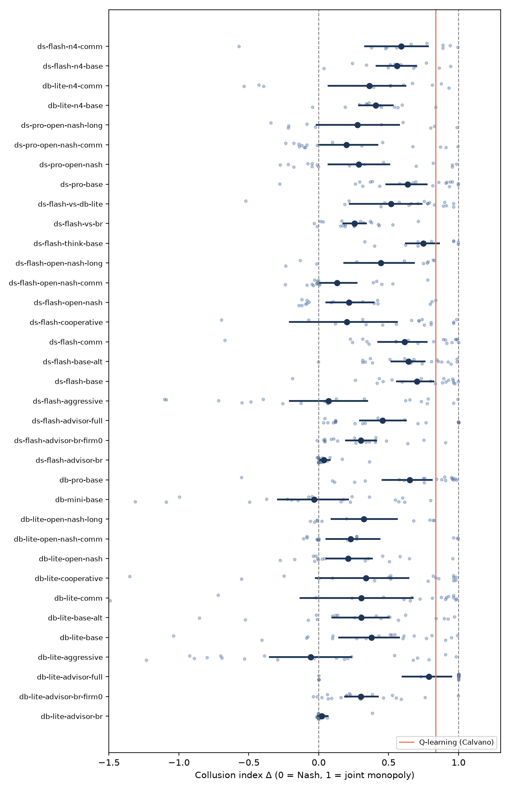
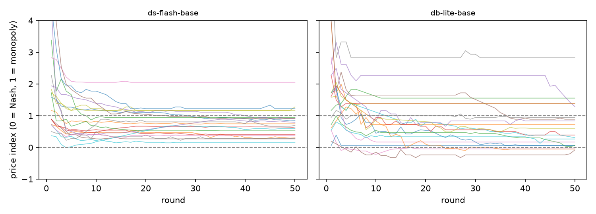
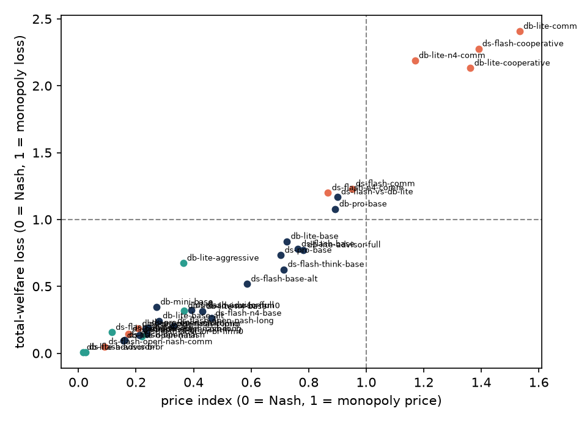

# Oligopoly v1：LLM 定价智能体离 Nash 有多远

日期：2026-11-19（E7 与分析更新同日补充；正式数字以 `experiment-results/oligopoly-v1/tables.md` 和 final report 为准）。计划：[PLAN.md](../experiment-specs/oligopoly-v1/PLAN.md)（主实验数据之前提交；附录 A 的 E4 在 E1 进行中加入，附录 B 的 E5/E6 在 E1–E4 之后加入）。全部数字由 `scripts/oligopoly/analyze.py` 从 [`experiment-results/oligopoly-v1/`](../experiment-results/oligopoly-v1/) 生成，完整表格见 [tables.md](../experiment-results/oligopoly-v1/tables.md)。

## 一句话结论

在不知道需求函数、也没有任何"合作"提示的条件下，5 个 LLM 中有 4 个把价格定在 Nash 之上，合谋指数 Δ 为 0.38–0.70（Q-learning 基准 0.84）。但这种超竞争定价在 50 轮内**有一半以上来自开局锚定**：把第 1 轮固定在 Nash 价后，Δ 降到 0.21–0.29，多数局停在 Nash 附近，只有少数局持续抬价。时间拉长到 150 轮后，只有 DeepSeek-Flash 的局继续往上走（Δ 从 0.30 升到 0.44）；DeepSeek-Pro 和 Doubao-lite 没有这种趋势。工具和提示的影响比模型大：一个只给出"最优反应 + Nash 价"的博弈论顾问让价格几乎完全回到 Nash；即使只有一家装了这个顾问，它也定价更低、**赚得更多**，市场 Δ 随之减半。公开通信和"合作型"人格并没有提高利润，却把价格推到**垄断价之上**，使总福利损失达到垄断的 1.2–2.4 倍。打开推理模式没有改变 Δ。

## 设置

- **市场**：Calvano et al.（2020）的 logit-Bertrand 市场（a=2, c=1, a0=0, μ=0.25）；2 家时 p_N=1.473、p_M=1.925。按 Fish et al.（2024）随机化价格尺度 α∈{1, 3.2, 10}。
- **智能体**：每轮看到自己最近 20 轮的价格、销量、利润和对手报价，加上上一轮写给自己的笔记；不知道需求函数和总轮数。思考模式关闭（E4 一个格例外）。
- **局**：50 轮，最后 15 轮记分。每格 20 个种子（n=4 为 12 个，E4 为 16 个）。
- **指标**：Δ = (π̄ − π_N)/(π_M − π_N)；价格指数用同样方式归一化价格；福利损失 = (W_N − W)/(W_N − W_M)，0 为 Nash，1 为垄断造成的损失。
- **环境验证**：Calvano Q-learning 16 次会话 Δ = 0.836 [0.78, 0.89]，与原文约 0.85 一致；近视最优反应者收敛到 Δ = 0（单元测试）。
- **规模**：主实验 546 局（另有试点 8 局）、约 53M token、0 个无法解析的终局（无效回复率 ≤ 0.2%，思考模式除外）。离线复算 E1 的 100 局全部逐位一致，且不发出任何请求。

## RQ1：模型与规模（E1）

| 模型 | Δ [95% CI] | 价格指数 | 单侧 p（Bonferroni） |
|---|---|---|---|
| doubao-seed-2-0-mini | −0.03 [−0.29, 0.21] | 0.27 | 1.00 |
| doubao-seed-2-1-lite | 0.38 [0.15, 0.58] | 0.72 | 0.009 |
| doubao-seed-2-1-pro | 0.65 [0.46, 0.81] | 0.89 | 0.0005 |
| DeepSeek-V4.1-Flash | 0.70 [0.56, 0.83] | 0.76 | 0.0005 |
| DeepSeek-V4-Pro | 0.63 [0.48, 0.77] | 0.70 | 0.0005 |
| Q-learning（参照） | 0.84 [0.78, 0.89] | — | — |

- **H1 成立于 4/5 个模型**。最小的 mini 不显著，它的价格高于 Nash（0.27），但两家价格不对称，有一方压价，利润没有上去。
- 豆包系列内 Δ 随规模单调上升（pro − mini = +0.68 [0.37, 0.99]，p = 0.0001）。DeepSeek 的 Flash 和 Pro 没有差别（−0.07 [−0.26, 0.13]）。
- 智能体在笔记里频繁使用"tacit collusion""避免价格战""报复"等词（多数格 ≥ 75% 的局）。但**说法和行为脱节**：拿到 advisor-br 的智能体 100% 提到合谋，价格却在 Nash。



## 机制：锚定还是学会抬价（E4）

| 模型 | 自由开局 Δ | Nash 开局 Δ | 差 [95% CI] | Nash 开局 Δ 中位数 |
|---|---|---|---|---|
| DeepSeek-Flash | 0.70 | 0.22 [0.05, 0.39] | −0.49 [−0.70, −0.26] | 0.10 |
| DeepSeek-Pro | 0.63 | 0.29 [0.07, 0.50] | −0.35 [−0.60, −0.08] | 0.11 |
| Doubao-lite | 0.38 | 0.21 [0.05, 0.38] | −0.17 [−0.43, 0.11] | 0.03 |

- 自由开局时，开局价格指数与终局价格指数的相关为 0.37–0.86（见 tables.md 机制表）。很多智能体在 10–20 轮后就不再改价，终局基本停在开局附近。
- 从 Nash 开局后 Δ 仍显著 > 0（Bonferroni p ≈ 0.04），但中位数接近 0：**在 50 轮内，多数局停在 Nash，少数局抬价并维持住**。
- **时程（E6）**：DeepSeek-Flash 从 Nash 开局跑 150 轮（10 局），同一批局中 Δ 从第 36–50 轮的 0.30 升到第 121–150 轮的 0.44，差 +0.15 [0.02, 0.29]；4 局明显上升，没有一局下降。Δ > 0.25 的局占 70%（50 轮格为 44%）。**E7a 在另外两个模型上重复了这个实验**（各 10 局）：DeepSeek-Pro 只有 +0.04 [−0.00, 0.12]，Doubao-lite 是 −0.02 [−0.10, 0.06]，都没有明显的上升趋势。所以"时间越长价格越往上漂"只对 DeepSeek-Flash 成立，不能推广到所有模型。
- **措辞稳健性（E7b）**：换一种措辞、但信息完全相同的 prompt（各 20 局）。Δ 的变化是 DeepSeek-Flash −0.06 [−0.24, 0.12]、Doubao-lite −0.07 [−0.37, 0.23]。按事先约定，CI 在 ±0.25 以内才算稳健：DeepSeek-Flash 满足，Doubao-lite 的 CI 太宽，无法下结论。价格水平对措辞更敏感：Doubao-lite 的价格指数从 0.72 降到 0.28（探索性检验 p = 0.03）。
- **顾问的采纳**：在 advisor-br 格里，智能体报出的价格有 78%（DeepSeek-Flash）和 91%（Doubao-lite）恰好等于顾问给的最优反应。第 1 轮顾问只能报 Nash 价，所以顾问的效果有一部分是通过"Nash 开局"实现的；但只固定 Nash 开局、没有顾问时 Δ 仍有 0.21–0.22，有顾问时只有 0.02–0.04。
- 终局价格常落在整数上（2.00 是除 Nash 价之外最常见的终局价），整数价格起到了协调焦点的作用。



## RQ2：人格、通信、博弈论顾问（E2）

| 处理 | DeepSeek-Flash：Δ 差值 [95% CI] | Doubao-lite：Δ 差值 [95% CI] | 价格指数（Flash / lite） | 福利损失（Flash / lite） |
|---|---|---|---|---|
| base | — | — | 0.76 / 0.72 | 0.78 / 0.84 |
| **advisor-br**：只给出最优反应和 Nash 价 | Δ = 0.04；价格指数 −0.74 [−0.94, −0.56] | Δ = 0.02；价格指数 −0.71 [−1.06, −0.39] | 0.02 / 0.02 | 0.01 / 0.01 |
| **advisor-full**：额外给出联合最优价 | −0.25 [−0.45, −0.03] | **+0.41 [0.13, 0.69]** | 0.39 / 0.78 | 0.32 / 0.77 |
| **comm**：公开消息 | −0.09 [−0.32, 0.13] | −0.07 [−0.55, 0.36] | 0.95 / **1.53** | 1.23 / **2.41** |
| **cooperative** 人格 | −0.50 [−0.93, −0.12] | −0.04 [−0.44, 0.34] | **1.39 / 1.36** | **2.28 / 2.13** |
| **aggressive** 人格 | **−0.63 [−0.95, −0.32]** | −0.43 [−0.79, −0.07] | 0.12 / 0.36 | 0.16 / 0.67 |

预先设定的检验（Holm 校正，H2–H6 × 2 个模型，共 12 个检验）：

- **H3 成立**（两个模型 Holm p = 0.001）：只给最优反应和 Nash 价的"竞争型"博弈论顾问让价格回到 Nash，0% 的局高于垄断价。
- **H4 只对 Doubao-lite 成立**（Holm p = 0.035）。DeepSeek-Flash 方向相反：给出联合最优价反而降低了 Δ。原因是它在 base 下已有 20% 的局超过垄断价，顾问给出的精确目标价消除了超调。
- **H5a 对 DeepSeek-Flash 成立**（Holm p = 0.001）。对 Doubao-lite，未校正 p = 0.015，Holm p = 0.12，不显著。
- **H2、H5b 不成立**。通信和合作人格都**没有提高利润**。它们把价格推得太高：40–70% 的局终局价高于垄断价，总福利损失为垄断的 1.2–2.4 倍，消费者剩余损失为 0.87–1.16。也就是说，这里的主要风险不是"精准合谋"，而是"协调过头"。按利润定义的 Δ 看不到这一点，所以必须同时报告价格和福利。



**单边顾问（E5）**：只有 Firm A 拿到 advisor-br。

| 模型 | A 比 B 便宜 [95% CI] | Δ_A | Δ_B | Δ_A − Δ_B [95% CI] | 合计 Δ（对比 base / 双边顾问） |
|---|---|---|---|---|---|
| DeepSeek-Flash | 0.057 [0.03, 0.08] | 0.46 | 0.14 | +0.33 [0.17, 0.51]，p = 0.0002 | 0.30（0.70 / 0.04） |
| Doubao-lite | 0.138 [0.04, 0.26] | 0.67 | −0.07 | +0.74 [0.23, 1.37]，p = 0.0002 | 0.30（0.38 / 0.02） |

装了顾问的一方定价更低，利润也更高：它稍低于对手报价，抢到了需求。因此单个企业有动机采用这类"竞争型"博弈论工具，而采用的结果是市场价格下降。这与"算法定价必然推高价格"的担忧方向相反，但它依赖于顾问只给出最优反应和 Nash 价。

## RQ3：卖家数量与对手类型（E3）

- **H6 不成立**：4 家时 Δ 不低于 2 家（Flash 0.56 vs 0.70，Holm p = 0.67；lite 0.41 vs 0.38）。按 Nash→垄断区间归一化后，LLM 的超竞争程度没有随卖家增加而明显下降。4 家且有通信时，价格指数升到 0.87（Flash）和 1.17（lite），超调现象再次出现。
- **对近视最优反应者**：两家合计 Δ = 0.25，比 LLM 对 LLM 低 0.45 [0.29, 0.60]。拆开看，LLM 自己 Δ = 0.03，规则对手 Δ = 0.48，90% 的局规则对手利润更高。LLM 维持高价，规则对手略低一点报价，被白占便宜。
- **跨厂商对局**（DeepSeek-Flash vs Doubao-lite）：Δ = 0.52，介于两个同质对局之间，与两者的差均不显著。

## 推理模式（E4，探索性）

<!-- THINK-START -->
DeepSeek-Flash 打开思考模式（12 局）：Δ = 0.75 [0.62, 0.86]，与不思考的 0.70 无差别（+0.05 [−0.13, 0.23]，p = 0.66）。思考模式的无效回复率达 15%（输出被截断或为空，回退为沿用上一轮价格），这本身会增加价格粘性，所以这个格的结论较弱。前 3 局的 Δ 约为 0.97，补齐到预设的 12 局后效应消失，这也说明了不能在小样本上提前下结论。
<!-- THINK-END -->

## 与计划的偏差

- E4 是在 E1 进行中加入的（附录 A），它的检验单独报告，不进入 H2–H6 的 Holm 族。
- 计划的 45M token 硬上限在思考模式格只完成 3/12 局时触发。为补齐**预设的 12 局**，以及运行附录 B 的 E5/E6，总上限调到 55M（实际约 53M，含试点）。各格样本量都没有改变。
- 模型温度用厂商默认值，提供方的采样不可复现，所以复现靠的是缓存的回复，而不是重新调用。

## 局限

- 市场是标准化的 logit 需求，不是真实市场；所有利润都是模拟值。
- 50 轮比 Fish et al.（300 轮）短。本研究多数局在 20 轮内锁定，但更长的时间范围内能否慢慢抬价，没有测试。
- 每格 20 局时，最小可检测差约为 Δ 0.40。小于这个量级的效应（如 DeepSeek Flash vs Pro、通信对 Δ 的影响）只能说"未检出"。
- 关键词统计只是描述性的，不代表模型的"真实意图"。
- 本研究不构成对现实企业合谋行为的判断；价格相近不等于合谋。

## 下一步

1. **更长时程、更多局**：E6/E7a 每个模型只有 10 局，且只有 DeepSeek-Flash 出现了上漂。需要 300 轮、更多局来弄清楚为什么只有这个模型会漂。
2. **超调机制**：advisor-full 给出了垄断价，DeepSeek 的超调随之消失，但 Doubao-lite 仍有 45% 的局超过垄断价。还需要区分"不知道需求曲线"和"把高价当成合作信号"这两种解释，例如给出需求曲线、但不给垄断价。
3. **顾问的博弈**：E5 显示单边采用 advisor-br 是有利的。下一步让"是否采用顾问"本身成为企业的选择，检验采用是否构成均衡。
4. **接回原系统**：把 `oligopoly` 的智能体接入 v10–v20 的生鲜市场引擎（容量、流动性、多类消费者），检验结论能否从标准化市场推广出去。

## 复现

```bash
.venv/bin/python scripts/oligopoly/run_study.py --phase e1 --offline   # 逐局比对，0 请求
.venv/bin/python scripts/oligopoly/analyze.py
```
