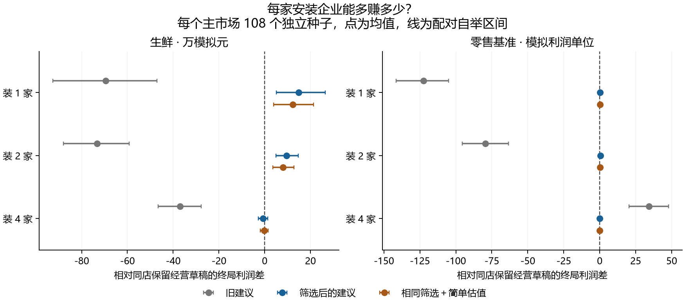

# 四家生鲜店，谁能从定价建议里赚钱？

前两批 108 个生鲜市场中，四家只有一家装新建议器时，这家平均多赚 **14.91 万模拟元**；在追试的 36 个全新市场中，原样使用同一策略却平均少赚 **3.56 万**（区间 −17.37 至 +5.84 万）。另外三家平均每家少赚 **5.23 万**，四家利润合计减少 0.79 万，区间跨零。把其余三家也装上，对同一家最先安装的店，平均收益下降 **17.22 万**，配对区间为 −28.63 至 −6.70 万。全装时所有安装企业平均比保留草稿少赚 0.66 万。安装比例改变了结果。

**目前能用公开报价筛掉一批昂贵错误；对手建模比相同筛选下的简单估值还有多少额外价值，未得到稳定确认。** 单装时，对手建模比简单估值平均多 2.62 万，区间从少赚 2.89 万到多赚 11.80 万。保留经营者草稿仍是默认。所有金额来自模拟结算。

本轮修复了两条定价流程。第一，建议器在改价前找 16 个不同历史市场的相似合同，把后续利润、销量和退市一起考虑，返回放行或弃权及原因。第二，直接报数的经营者能从当前可执行的价格范围中随机选择。另对经营者做了一项独立试验，检验加价四轮到期后，能否靠自己的账判断应该撤回。历史实验标签只用于训练，线上筛选只接收已公开价格、当期草稿、日期与建议方向。经营模型和建议器各自可见的信息有明确区别。

两个主市场各 108 个九档新种子，首批各 36 个，独立第二批各 72 个，另有 36 个预约市场和 24 个直接报价市场，最初两阶段合计 276 个不同市场种子。后续对称到期追试再加 72 个，第二种经营模型复用直接报价场景，全阶段共 348 个不同种子。四店使用同一真实本地模型，分别抽样、同时报价，均结算至第 60 轮。截止冻结时没有用设备更新型人格调参。生鲜单装收益在两批分别为 +9.57 万和 +17.59 万；全装分别为 +0.55 万和 −1.26 万。以下合并独立种子的配对估计，同一市场的不同安装安排和两种续约方式不重复计作独立样本。

最新版本增加了真实亏损率检查和逐家对手报价输入，因此同一示例目前可能引用更多历史市场。下文的 16 个市场是原版实验记录。最新检查方法见[四环节定位与修复](price-causes.md)。

## 拿一单建议来核对

运行 `python scripts/four_prices/review_price.py experiment-specs/price-guard-v1/proposal.json`。样例取自新生鲜市场 196024 第 27 轮，仅输入最近八轮公开报价、本店草稿和“涨 4%”候选。程序返回保留草稿，并列出可核对的 16 个旧市场编号。它们的平均终局增益约 3.78 万，但计入大额亏损后评分降至 −1.34 万。这个命令可以检查新的同格式候选，不需要启动模型，也不会替企业执行调价。

## 每家店多赚了多少

0 家安装时，各店照自己的草稿报价，利润差定义为零。下表是每家安装企业从第 19 轮折现至第 60 轮，相对同店照草稿报价的利润差。方括号为按市场种子配对自举的 1.25% 和 98.75% 分位。每个市场独立计量。

| 市场 | 安装数 | 旧建议 | 新筛选＋对手建模 | 新筛选＋简单估值 | 建模比相同筛选的简单估值多赚 | 新筛选最差一店 |
|---|---:|---:|---:|---:|---:|---:|
| 生鲜（万模拟元） | 1 | -69.49 | +14.91 [+5.19, +26.56] | +12.29 | +2.62 [-2.89, +11.80] | -95.29 |
| 生鲜（万模拟元） | 2 | -73.22 | +9.55 [+4.88, +14.65] | +7.93 | +1.62 [-0.77, +4.18] | -183.50 |
| 生鲜（万模拟元） | 4 | -36.98 | -0.66 [-2.72, +1.42] | -0.15 | -0.51 [-1.71, +0.74] | -252.43 |
| 零售（利润单位） | 1 | -122.48 | +0.20 [-0.42, +1.20] | +0.20 | +0.00 [+0.00, +0.00] | -15.20 |
| 零售（利润单位） | 2 | -79.41 | +0.59 [+0.00, +1.44] | +0.37 | +0.22 [+0.00, +0.89] | -24.12 |
| 零售（利润单位） | 4 | +34.11 | -0.05 [-0.39, +0.29] | -0.02 | -0.03 [-0.13, +0.00] | -51.19 |
| 预约（利润单位） | 1 | -57.52 | -0.42 [-1.66, +0.00] | -0.07 | -0.34 [-1.38, +0.00] | -14.95 |
| 预约（利润单位） | 2 | -40.68 | +0.49 [+0.00, +1.97] | +0.46 | +0.03 [+0.00, +0.12] | +0.00 |
| 预约（利润单位） | 4 | +13.68 | -0.81 [-2.40, +0.00] | -1.87 | +1.06 [-0.12, +4.40] | -63.42 |

## 哪些建议被挡住，哪些仍然会亏

每个市场在事前抽定一家公司和一份合同，并把改价、维持草稿两条路都跑到终局。表内“拒绝”只数原建议确实能改变成交报价的机会，原本无变化的报价不算。

| 市场 | 预定机会 | 放行 | 放行后亏损 | 亏损率单侧98.75%上界 | 拒绝 | 拒绝中本会亏损 | 被拒建议若执行的平均损益 |
|---|---:|---:|---:|---:|---:|---:|---:|
| 生鲜（万模拟元） | 108 | 18 | 7 | 67.3% | 62 | 47 | -23.10 |
| 零售 | 108 | 1 | 1 | 100.0% | 60 | 46 | -33.96 |
| 预约 | 36 | 0 | 0 | 无法估计 | 19 | 10 | -8.41 |

原验收线同时要求每个预定机会的利润下界超过生鲜 2 万模拟元、零售 5 单位，实际放行至少 10%，且实际放行后亏损率的上界不超过 10%。持续安装以每店十个预定合同为分母；风险用随机撤掉单次建议估计。预约的 5 单位只作迁移参照。

## 经营者自己撤回一次失利加价

在独立确认的每市场 72 局中，同样安装筛选后的建议器。若上份合同加过价且自己的销量和利润都下降，下一份合同先扣回加价额，同时暂停一次新建议。表内是相对有筛选但没有撤回的额外利润。

| 市场 | 装 1 家 | 装 2 家 | 装 4 家 | 各组撤回次数 |
|---|---:|---:|---:|---|
| 生鲜（万模拟元） | +0.90 [-1.53, +5.14] | +0.67 [-0.78, +3.48] | +0.29 [-0.36, +1.14] | 2 / 2 / 3 |
| 零售 | +0.00 [+0.00, +0.00] | +0.00 [+0.00, +0.00] | +0.00 [+0.00, +0.00] | 0 / 0 / 0 |

## 人格与四家都装后的价格

人格只改变经营者提示。新人格要求用交易收入更新设备并留住客户，规则冻结前未用其结果训练。随机组每家独立抽取一种人格，在一局中保持。下表列出全装时各组平均利润差，以及与零安装相比、同一对企业在两条路都营业时的价格变化。相对价差为两家报价差的绝对值除以两家的均价。

| 市场 | 均衡 | 新人格 | 随机人格 | 同价概率变化（百分点） | 相对价差变化（百分点） |
|---|---:|---:|---:|---:|---:|
| 生鲜（万模拟元） | -0.20 | -0.89 | -0.87 | +0.09 [-0.08, +0.32] | -1.87 [-2.43, -1.31] |
| 零售 | -0.33 | +0.08 | +0.09 | -0.03 [-0.09, +0.00] | +0.06 [-0.00, +0.14] |
| 预约 | -1.83 | -0.59 | +0.00 | +0.00 [+0.00, +0.00] | +0.06 [-0.08, +0.30] |

## 两笔最坏的亏损

**只有一家安装时，最坏的店比自己照草稿少赚 95.29 万模拟元。** 它只在第 23 轮接受过一次加价，草稿 120.77 元，改成 125.60 元。单独撤掉这份建议，计到第 60 轮多赚 99.20 万，其中 78.27 万来自头四轮之后。两条路径都营业到最后。按模拟器重建，累计销量由 107,000 降至 80,466，缺货再分配后流失的订单却由 4,617 降至 4,086；这个个案的销量差主要来自分到的潜在需求变少。把三家对手的报价申请固定在无安装轨迹，该店仍少赚 90.33 万。

**四家全装时，最坏的单店少赚 252.43 万。** 它是随机人格市场里的第三家店，仅在第 27 轮接受一次从 125.09 元到 130.10 元的加价。在其他店继续使用建议器的条件下，只撤掉它这一份建议，终局可挽回 113.81 万，其中 99.40 万来自头四轮之后。实际销量由 128,765 降至 57,179，潜在订单由 135,757 降至 59,013。把三家对手的申请报价固定为无安装路径后，该店的利润差归零；这个受控对照也改变了该店随后看到的公开报价和决策。几条撤回路径的金额不能相加。这里的最差只指样本中见过的损失。

生鲜单装时，最差 5% 的单店平均损益从旧建议的 −303.95 万改善为 −50.26 万；全装从 −306.00 万改善为 −131.93 万。单向的加价撤回也有盲点。双装时最坏的预抽合同恰好是**降价**，头四轮多赚 564 元，到终局少赚 105.85 万。仅靠检查本合同是否多赚，会放过这笔损失。

## 报价是否还被强行压成一样

直接报价各市场用了 12 个新种子。旧接口接受任意数字再裁剪；在零安装下，生鲜 347 个不同请求里有 177 个越界，零售 672 个里有 384 个越界。新接口在各安装组的 2,994 个不同请求中全部直接给出当时合法的数值。与旧接口按同一市场、两条路径都有在营企业对的种子比较，生鲜同价比例平均下降 28.01 个百分点（10 对可比市场），零售下降 35.12 个百分点（12 对）。生鲜仍有 16 个企业对/轮原始报价不同但实际结算同价，合同内后续轮次的库存、经营状态与价格约束仍可改变执行结果。

在每个市场取同一条提示、同一人格，重复 32 组四家独立抽样。生鲜、零售各 128 次都得到 32 种价格；生鲜同组的 192 对报价有 37 对相同，零售有 54 对相同。系统允许模型自然撞价。生鲜 48 家店中，新接口仅 14 家经营到最后，旧接口 15 家。新接口直接报数时，筛选器单装每家平均少赚 0.38 万，全装多赚 1.36 万，两项区间都跨零；不能把九档报价的单装优势推广到自由报价。

## 加价和降价都只保存四轮，会不会更好？

在查出降价也能造成延迟损失后，另行冻结了对称到期方案。从前两批未见的 72 个市场各跑两遍，生鲜和零售各 36 个。如果建议确实改了价，到期就让店长从留存的原草稿价格重新试价。它仍能看到这四轮实际发生的销售和利润。

| 生鲜每家店，万模拟元 | 装 1 家 | 装 2 家 | 装 4 家 |
|---|---:|---:|---:|
| 同一批新市场，原筛选规则继续滚动 | −3.56 | +11.70 | −1.64 |
| 筛选后，调价四轮到期 | −5.10 | −0.33 | −0.10 |
| 四轮到期的额外收益与配对区间 | −1.53 [−15.22, +13.77] | −12.02 [−22.43, −3.65] | +1.53 [−1.70, +4.90] |

对称到期能改善旧无筛选方案，但给已筛选的双店方案加上它反而显著少赚。零售单装和双装的有无到期差均为零。两市场均未通过原门槛。第三批生鲜原筛选器另外拒绝了 24 次会改变报价的孤立建议，其中 21 次真会亏；放行的 4 次里有 2 次亏。这重复了它能挡掉损失的发现，也再次暴露它放行时不够稳。

## 换掉经营模型后

将同一批 24 个直接报价场景原样交给 Qwen2.5-0.5B-Instruct，筛选器仍只使用早期 SmolLM2 实验训练出的历史标签。5,168 个不同模型请求全部给出可执行的报价。零安装时，Qwen 经营的 48 家生鲜店有 35 家营业到最后，SmolLM2 是 14 家。换经营者模型本身就会显著改变这批场景中的生存数量。

生鲜 Qwen 单装相对草稿平均 **+0.10 万**（−0.22 至 +0.55 万），双装 **+1.65 万**（−8.22 至 +13.96 万），全装 **−1.69 万**（−8.59 至 +2.72 万）。零售三组筛选后的推断建议相对草稿的平均增量均为零。新模型能使用同一接口和规则，但尚无跨模型稳定增收的证据。Qwen 在项目早期其他实验中用过，本次没有用它拟合或挑选筛选器。两种模型都是本地真实推理。

## 验收决定与下一阶段

- **工程验收通过。** 核对 638 条历史配对标签、10,608 条终局轨迹（主试验与独立确认 7,584、对称到期 2,592、换模型 432）和 54,699 个实际经营请求，另有 256 次相同提示压力测试。17 个市场/处理组合逐步离线完整回放，另有 6 个最差案例各自撤掉每一轮建议并复算。562 项工程测试通过，现有 Starlette 测试依赖有一条弃用提醒。商业模型新增支出 0 元，按项目原有台账剩 0.155084 元，未计本机电费。
- **弃权有选择价值，但未达自动执行的要求。** 生鲜 62 次被拒的有效改价里，有 47 次真会亏，也错过 15 次赚钱机会；18 次放行里仍有 7 次亏。实际放行的平均增益为 11.13 万，被拒建议若执行平均少赚 23.10 万。多数拒绝由历史长期回报触发。单装持续运行平均每个预定合同多赚 1.49 万，下界仅 0.52 万，低于部署要求的 2 万；所有市场、安装比例与独立确认均未通过联合门槛。
- **经营者侧撤回能救旧方案，叠加到新筛选后增量有限。** 在原来无筛选的生鲜策略上，单装、双装、全装每家分别挽回 31.20、42.68、36.01 万。筛选后，同三组一共只触发 2、2、3 次；追加收益区间都跨零。公开建议器的结果和经营者使用自己账目的结果应分开报告。
- **可以交付的功能是给高风险建议标理由和损失证据。** 自动改价不晋级。单向撤回和对称到期均已独立检验；把已知差建议挡住，比怎样机械地撤回更有重复证据。复杂建模要取得部署资格，仍需在同数据、同筛选的简单估值之上产生可重复净收益，并把放行亏损压到预定线以内。用不同安装比例、零售基准和容量受限预约服务得到的结果，只支持特定模拟环境的研究结论。自然自由报价下可重复的利润提升、企业实际采纳和真实交易收益仍没有得到验证。

[冻结方案](../experiment-specs/price-guard-v1/PLAN.md) · [第二批确认方案](../experiment-specs/price-guard-v1/RENEWAL.md) · [对称到期追试](../experiment-specs/price-guard-v1/EXPIRY.md) · [跨模型协议](../experiment-specs/price-guard-v1/MODEL.md) · [复算方法](../experiment-specs/price-guard-v1/REPRODUCE.md) · [原始与汇总结果](../experiment-results/price-guard-v1)
