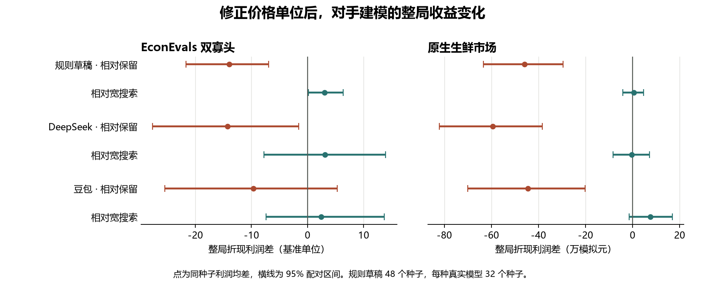

# 企业应该何时保留原定价计划

2026-11-18。项目已在生鲜市场的企业定价入口接入预热选价和跨周期利润反馈。公开信息中的对手反应有时有助于搜索；把它用于覆盖一个已经能从利润中学习的企业计划，尚无跨市场的可靠整局优势。事前筛选能减少坏建议的比例，但目前没有同时通过利润、覆盖和损失风险门槛的主动策略。

## 比较对象与执行合同

企业使用自己的已执行价格、销量、已结算利润，以及对手上轮公开价格。原生多企业控制把其他企业价格汇总为中位数。本轮对照用两家企业，隐藏的需求参数、对手规则、冲击时点和反事实收益均由评价器持有。论文中的对手模拟证据来自重复谈判；这里双方同时选价，别人的当期动作只可能响应此前已公开的信息。保留原计划的设计借鉴 SPIBB，本文报告的是实测损失，没有该论文特定 MDP 设置的理论保证。[文献和原文](pricing-feedback-literature.md)

- **合同**。以首轮公开己价为参考，前六轮分别请求其 88%、100%、112%，各持有两轮。第 7 轮起，先取预热中平均利润最高的价。此后每四轮用两个周期的已结算利润和实际价格决定下一次试价的方向，步幅 3.5%。最后一期随对局截短。原生市场每轮仍执行统一的资金、价格等约束，记录申请价和执行价。第一批确认的生鲜反馈组共 11,520 个结算轮，289 轮执行价与取整后的合同价不同。
- **正常入口**。四方批量实验工作台 → 企业控制 →「预热选价与四轮利润反馈」。查看策略依据可见每份合同的有效起止轮、当轮结算价和下次重定价轮。其他经营动作沿用原组合。中断恢复使用已有决策日志。工作台里的这项选择完全本地运行。
- **四组主比较**。A 固定预热最佳价，B 按周期反馈。C 从相同观察中预测无条件的对手价格变化，D 按己方上一轮公开变价的方向预测条件反应。C/D 都围绕当期 B 草稿评估 5 个候选 × 9 条预测路径。额外的 W 把预算改投 15 个候选 × 3 条路径，每个完整合同都是 180 个预测转移。短周期间隔、候选生效范围和结算折现各组相同。学习筛选增加少量回归运算；这里匹配模拟转移数，未要求 CPU 时间逐毫秒相等。
- **样本与指标**。各种子在同一市场内配对独立演化的完整路径，主指标为企业 60 轮按 0.99 折现的总利润，按种子整簇重采样 4,000 次取 95% 区间。稳定、需求永久变化、对手切换、反向回应四种条件等权；后三种各自与同种子稳定孪生配对。需求上升或下降的方向在规则组平衡分配。设定主动门需同时优于 B 与等预算简单搜索，覆盖至少 10%，在有干预的种子中“至少一个受干预条件整局亏于原计划”的比例，其单侧 95% 精确上界不超过 10%。不跨市场合并金额。场景与模型的细分区间不作多重比较校正。[第一批事前设计](../experiment-specs/pricing-feedback-v2/PLAN.md) · [确认前冻结](../experiment-specs/pricing-feedback-v2/CONFIRM.md)

## 反馈本身有多大价值

在作者的 EconEvals **单产品 Basic 定价任务**上，另外生成 24 个新种子，每局 100 轮。评分为后 50 轮实得经营利润除以作者求解器给出的同期最优利润。线性变化 12 种子，反馈定价得 **0.9978**，预热固定价 0.8989，上一阶段简单搜索 0.9459。反馈相对上一阶段高 0.0519 [0.0440, 0.0607]。周期变化 12 种子，三者分别为 **0.6469、0.6126、0.6586**，反馈相对上一阶段为 −0.0117 [−0.0958, 0.0619]。单产品没有对手，这部分只验证反馈控制。下表外部市场使用作者双寡头结算并加入实验冲击；其 60 轮回报属于本研究扩展指标。[官方任务成绩与种子](../experiment-results/pricing-feedback-v2/official.json) · [作者定价任务](https://arxiv.org/html/2503.18825v4)

首批确认每市场 48 个新种子、每种子四种条件、10 组闭环。区间为配对差。生鲜单位为模拟元。

| 60 轮整局利润差 | EconEvals 双寡头 | 原生生鲜 |
|---|---:|---:|
| B − 预热固定价 | +7.31 [2.63, 11.99] | −77,437 [−191,930, 39,049] |
| B − 原有规则（外部取初始价） | −3.75 [−9.91, 2.43] | +337,225 [171,000, 508,846] |
| D − 同候选 C | +1.29 [−1.16, 4.57] | +7,998 [−1,827, 17,494] |
| D − 多候选 W | +1.86 [−0.11, 4.25] | +13,508 [392, 27,235] |
| D − 保留 B | **−28.02 [−36.30, −20.18]** | **−801,283 [−1,006,994, −597,400]** |

A 在生鲜是有竞争力的低成本对照。单独挑选搜索策略之间的优势，会高估企业采纳建议的价值。[全组收益、消费者剩余、分场景和风险](../experiment-results/pricing-feedback-v2/confirm.json)

## 需求变了或对手换策略后多久调整

下表将“响应”记为相对无冲击孪生路径首次出现连续两轮至少 1% 的实际执行价差。延迟是从隐藏变化发生至这两轮中第一轮的间隔，取有响应种子的中位数。三个条件首次出现可读区别的中位时间均为下一轮。末列把变化后的 B 与“变化前沿同一 B 路径、此后冻结上一实际价”的剩余利润配对。后者仍受生鲜合法执行约束。

| 市场、变化 | 有响应 / 48 | 响应延迟 | 变化后 B − 冻结价，95% 区间 |
|---|---:|---:|---:|
| 外部 · 需求变化 | 38 | 5.5 轮 | +4.98 [−1.22, 11.37] |
| 外部 · 跟价或压价 | 47 | 6 轮 | +11.99 [1.21, 22.78] |
| 外部 · 未见的反向回应 | 48 | 7 轮 | +19.86 [8.73, 31.94] |
| 生鲜 · 需求变化 | 43 | 5 轮 | −106,314 [−223,760, 15,060] |
| 生鲜 · 跟价或压价 | 38 | 10.5 轮 | −30,066 [−144,000, 77,655] |
| 生鲜 · 未见的反向回应 | 38 | 7 轮 | +41,764 [−76,322, 166,734] |

例如生鲜需求变化时有 43 个种子的执行价响应，42 个种子的请求价响应。需区分市场价格约束与企业主动行为。生鲜三类变化中尚不能确认这些调整比冻结更赚钱。[冲击与孪生轨迹结果](../experiment-results/pricing-feedback-v2/confirm.json)

## 事前能否认出应该弃权的机会

首版直接预测利润，在外部开发集分数最高的一成机会中，32 次里 26 次四轮收益受损。随后把直接利润估计与按销量、单位利润估计的结果合并，再仅用开发种子训练一个可事先打分的正则逻辑回归。24 个独立校准种子决定放行阈值。严格门在两个市场均找不到合格阈值，最终执行产生零干预和零增益。下面单独报告事前冻结的较宽松诊断门。

每市场 2,496 个完整的四轮决策机会，同时结算替换及保留两条分支，其中也包含全部遭拒建议。生鲜入选 494 次，平均短期 **+17,177 元**，亏损率 **28.95%**；拒绝组平均 −29,784 元，仍有 28.72% 实际获益。外部入选 408 次，平均 −0.95，亏损率 51.72%；拒绝组平均 −4.95。学习分数判别正收益的 AUROC 分别为生鲜 **0.756**、外部 **0.669**。持续让诊断门接管时，以整个合同内是否确实改变执行价计，机会覆盖分别为 14.73% 和 19.68%（只看首轮为 14.43% 和 19.68%），整局相对 B 为生鲜 **−101,977 [−211,449, −336]**、外部 **−8.73 [−14.20, −3.45]**。短期入选比例和闭环实际覆盖的分母不同，后者包含末次截短合同、受执行约束且历史随干预改变。[全部机会标签](../experiment-results/pricing-feedback-v2/prospective-labels.json.gz) · [校准试过的阈值](../experiment-results/pricing-feedback-v2/learned-thresholds.json)

据此把训练目标从“四轮利润”改为“**仅替换一次合同，此后根据改变后的实际历史继续按 B 经营，直至终局**”。使用新训练 24、新校准 24、新确认 48 个种子；用完整闭环校准覆盖与损失。单次建议的四轮收益与余下终局收益出现正负类别翻转，外部 **24.92%**、生鲜 **29.53%**。终局打分在留出集的 AUROC 只有 **0.611 / 0.661**。放行诊断门多次接管，外部相对 B **−21.49 [−30.78, −13.24]**，生鲜 **−116,739 [−211,265, −32,148]**。风险上界为 88.24% / 95.80%；严格门仍全部弃权。探索性地只允许首次通过的完整合同接管一次，外部 +0.24 [−2.31, 2.57]，生鲜 −67,306 [−159,432, 17,688]。外部选时相对同一批入选局中均匀随机选时更好，但尚未证明超过保留原价。[第二次独立确认](../experiment-results/pricing-feedback-v2/long-confirm.json) · [单次接管审计](../experiment-results/pricing-feedback-v2/audit.json)

## 报价与每单利润的换算

独立核算发现，外部市场对标价按价格尺度转换后计算每单利润，原搜索器的辅助销量模型假定报价每增加一单位，单位利润也增加一单位，因而有量纲偏差。补做的修正版从历史相邻窗口中的已执行价格、销量和利润估计换算斜率，沿用相同候选、预测情景与原生安全约束。第三批独立确认再用 48 个新种子、四种条件。

| 报价换算后的 D | 外部整局差，95% 区间 | 生鲜整局差，95% 区间 |
|---|---:|---:|
| 相对修正前 D | +11.12 [6.44, 16.28] | +271,505 [150,980, 401,288] |
| 相对同样修正的 C | +5.66 [1.15, 11.44] | +4,066 [−41,391, 47,779] |
| 相对同样修正的 W | +2.99 [0.13, 6.36] | +5,003 [−42,082, 47,378] |
| **相对保留 B** | **−13.99 [−21.65, −6.93]** | **−458,758 [−634,263, −294,463]** |

这次对照支持“外部市场中，对手模型能让搜索更好”，也量化了“改进搜索”与“企业应当接受建议”的差距。该换算依然是从观测数据估计，在生鲜市场会受到库存、支出和需求共同变化的影响。[单位换算设计](../experiment-specs/pricing-feedback-v2/UNITS.md) · [全组结果](../experiment-results/pricing-feedback-v2/units.json)

## 用真实企业 Agent 的原计划再做配对

真实模型每次看到自己所在分支已经结算的历史、可选价格范围、四轮期限和反馈规则给出的参考价，自行提交一个价格。实验中的原计划就是此回复。干预后的下一份草稿重新向该模型征求。固定以 DeepSeek Flash 和豆包 Seed 2.0 Lite 260428 为两个草稿来源；没有把模型当市场裁判。对手仍是实验中可复现的策略，价格以真实上游函数或原生引擎结算。

每模型每市场先行 6 种子，随后另取 32 个种子。每一批同一模型各组使用相同的信息和重决策时钟，同一可见提示复用同一回复。32 种子批按种子依次各分 8 个稳定、需求变化、对手切换和反向回应。这里的「需求变化」恰为下移，「对手切换」为较高跟价；两种方向均覆盖的结论来自前文每种子遍历所有场景的规则试验。真实模型只控制焦点企业的价格，其他经营动作仍按原组合执行。

| 32 个新种子，各模型自己的配对利润差 | 换算修正的 D − 保留真实草稿 | 同版 D − 多搜价格 W |
|---|---:|---:|
| DeepSeek，外部双寡头 | **−14.29 [−27.61, −1.57]** | +3.13 [−7.75, 13.88] |
| 豆包，外部双寡头 | **−9.69 [−25.46, 5.32]** | +2.45 [−7.40, 13.67] |
| DeepSeek，生鲜 | **−593,386 [−820,778, −382,951]** | −2,943 [−83,362, 71,580] |
| 豆包，生鲜 | **−444,785 [−700,686, −202,466]** | +75,218 [−15,060, 168,621] |

修正版 D 实际干预的种子中，DeepSeek 在外部 20/30、生鲜 28/32 整局低于保留真实草稿；豆包分别是 13/27、24/31。原版 D、生效阈值冻结的筛选及先导结果全部保留。一次格式失败的兜底曾令同一提示在不同分支出现不同草稿；审计逐条重算提示，固定首次两次尝试的结果，归档并重新运行受影响的五条轨迹。复核 10,668 个决策、6,002 个不同的模型可见提示，相同提示与种子对应多个草稿的情况降为零。模型偶有连续格式无效，兜底使用已展示的规则参考价；各组兜底次数见原始统计。[真实草稿实验设计](../experiment-specs/pricing-feedback-v2/REAL.md) · [原版及筛选](../experiment-results/pricing-feedback-v2/real-confirm.json) · [修正后结果](../experiment-results/pricing-feedback-v2/real-units.json) · [配对提示审计](../experiment-results/pricing-feedback-v2/prompt-audit.json)

## 复查与重跑

本地原始逐期轨迹、成对分支和计费流水位于 `runs/pricing-feedback-v2`；便于复算的摘要、逐局利润及完整机会标签放在 `experiment-results/pricing-feedback-v2`。运行环境为项目 Python 3.12 虚拟环境，沿用上一阶段固定的 EconEvals 提交 e1f2a40fec96f0d27f5414873c4310f2b5c51935。仓库 Git 基点为 aeff85c，本阶段工作在本地工作树。第一批确认的冻结清单校验代码、方案、系数和阈值共九个文件。单独用 logit 闭式公式重算外部第一批 115,200 轮，数量、利润的最大舍入误差为 0.00499995，并核对消费者剩余。两市场共检查 230,400 轮合同覆盖及冲击前孪生一致性。全量后端 **553** 项、上游定价 **11** 项、前端构建后测试 **32** 项通过，TypeScript 类型检查通过。[独立核算](../scripts/pricing_feedback/audit.py) · [定价合同与恢复测试](../tests/test_cycle_pricing.py)

从仓库根目录使用 `.venv/Scripts/python.exe`，以下为离线重算顺序。已保存的原始轨迹可直接运行分析和审计；常规验证无须再次请求模型。

~~~text
scripts/pricing_feedback/study.py dev
scripts/pricing_feedback/analyze.py fit
scripts/pricing_feedback/study.py cal
scripts/pricing_feedback/analyze.py cal
scripts/pricing_feedback/study.py confirm
scripts/pricing_feedback/analyze.py confirm
scripts/pricing_feedback/official.py
scripts/pricing_feedback/long_horizon.py train
scripts/pricing_feedback/long_horizon.py calibrate
scripts/pricing_feedback/long_horizon.py confirm
scripts/pricing_feedback/units.py
scripts/pricing_feedback/audit.py
scripts/pricing_feedback/exposure.py
scripts/pricing_feedback/figure.py
scripts/pricing_feedback/verify_delivery.py
~~~

真实调用入口依次为 `paid.py`、`paid_confirm.py`、`paid_units.py`、`real_once.py`，都在 `scripts/pricing_feedback`，读取进程内对应供应商凭据，共用原子预留账本。输入、输出按不低于本次所用短文本端点刊例单价的 4 / 16 元每百万 token 计保守预算占用，未知用量保留整次预留，模型调用 SDK 自动重试关闭。严格上限为本阶段人民币 50 元。供应商账单与平台实际折扣未核对。[DeepSeek 官方价格](https://api-docs.deepseek.com/zh-cn/quick_start/pricing/) · [火山方舟官方价格](https://docs.volcengine.com/docs/ark/model-pricing?lang=zh)

## 用真实草稿训练后，每局最多介入一次

最后将草稿来源和长期目标同时对齐。从两个真实提供方的轨迹训练筛选器，每市场 32 个种子、64 个机会，按种子一起留一校准。在 48 个全新种子上，每模型每市场只安排一次事前确定的完整调价机会，各市场各 96 个机会，共 192 次。每个机会都跑“执行四轮候选后交还真实模型”和“始终尊重真实草稿”两条到第 60 轮的路径。其他轮均保留企业当时的原计划。对经营测算而言，这个问题比随时都能介入容易；拒绝者也有完整终局标签。[冻结设计](../experiment-specs/pricing-feedback-v2/REAL-ONCE.md) · [逐次机会](../experiment-results/pricing-feedback-v2/real-once-opportunities.json.gz)

| 全新真实机会，按市场合并两模型并对共同种子聚类 | EconEvals 双寡头 | 生鲜 |
|---|---:|---:|
| 诊断门放行 / 全部机会 | 16 / 96 | 22 / 96 |
| 放行机会实际亏损；拒绝机会实际亏损 | 37.5%；71.3% | 59.1%；78.4% |
| 识别正收益的 AUROC | 0.728 | 0.573 |
| 只有一次机会时，筛选策略整局收益差 | +2.85 [−0.34, 6.69] | +43,137 [−22,695, 134,551] |
| 任一模型受损的种子 / 曾放行种子 | 6 / 10 | 8 / 11 |
| 条件损失风险单侧 95% 上界 | 85.0% | 92.1% |

自动放行所有首轮能执行不同价格的候选，外部整局少赚 9.65 [−19.20, −0.62]，生鲜少赚 142,685 [−266,169, −7,908]。筛选改善了这两组的点估计，但与企业原计划相比，两个区间仍含零。严格门均选择零放行，损失条件概率无定义。一次性诊断门的覆盖分母仅为每局预排的一次机会，不能转作十四次常规决策机会的覆盖率。在生鲜另有两个真实机会的首轮受价格约束而相同，后续三轮出现执行差异。它们按事前首轮可执行标准留在放行范围之外，同时保留了完整双分支。重复干预试验另外复核整个合同的实际覆盖；首批生鲜诊断门有 8 次价格差延迟生效。[单次终局验证](../experiment-results/pricing-feedback-v2/once-confirm.json) · [全期限覆盖复核](../experiment-results/pricing-feedback-v2/term-exposure.json)

## 阶段决策、差距与预算

**工作台保留可选的反馈定价，企业原计划继续由企业控制；条件对手模型与弃权筛选保留作离线研究。** 规则来源第三批里，修正后 D 相对 B 的平均整局利润缺口为外部 1.10%、生鲜 16.54%。对真实草稿，生鲜缺口为 DeepSeek 22.14%、豆包 16.89%。两类模型在生鲜的整局区间均排除零。真实单次筛选出现部分预判信号，在外部减少坏建议最明显；当前两个市场的风险上界依然分别超出 10% 门槛约 75 和 82 个百分点。没有足够证据让建议器自动改动企业价格。本结论覆盖这些 60 轮模拟、有限对手与价格动作；未用真实企业交易校准，也没有考察所有企业同时采用建议器后的均衡。

下一实现阶段主线是**建立公开反馈能否区分需求变化与对手反应的检验**。保留预热固定价、跨周期反馈和真实模型草稿三条对照，在同一公开历史上并列检验需求/销量预测、对手下一轮报价预测，以及二者相对于简单滞后预测的误差。生鲜项另记录可售量、缺货与价格约束持续期，观察哪些价格差真正能执行。先在未见市场条件下核对预测误差能否预示企业的终局收益差，再决定是否投入新的自动接管开发。C/D/W、完整拒绝标签和逐轮台账继续作为回归基准。

真实请求 **12,460 次**，得到 **12,333 个有效数字回复**；另有豆包 122 个格式无效回复、DeepSeek 4 次连接错误、豆包 1 次超时。供应商返回用量合计 **5,596,533 输入、87,326 输出 token**。所有尝试及用量未知的错误均计入同一上限，**保守预算占用 23.81 / 50 元**。余额没有作为追加实验的理由；最后一项独立确认已达到事前设定的阶段停止条件。[交付审计与计费分项](../experiment-results/pricing-feedback-v2/delivery-audit.json) · [文件哈希清单](../experiment-results/pricing-feedback-v2/manifest.json)

