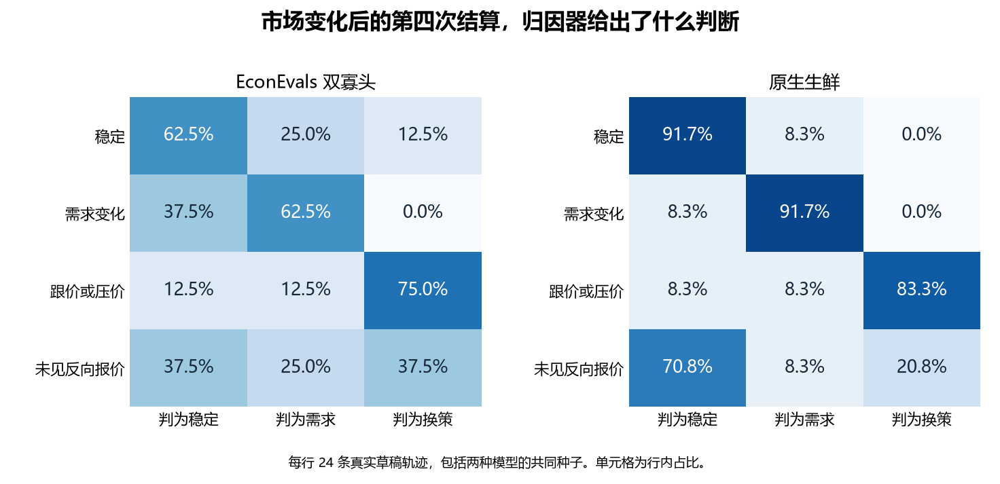

# 从公开预测到终局调价价值

2026-11-18。EconEvals 双寡头和原生生鲜都能从已结算公开信息中预测下一轮销量及对手报价。预测精度、判断变化来源和挑选有长期收益的干预，三者的实测表现差异很大。在生鲜，缺货和价格约束提高了预测精度，但市场总体销量容易预测时，更改单家企业报价能带来多少额外销量仍难估准。

## 研究设计

焦点企业可见自己的价格申请、执行价、销量、利润及对手上一轮公开报价。生鲜增加上轮已公开的市场需求、未能满足的订单数，及本轮自己的可执行价格上下限。上下限通过企业原有动作校验器取得。对手本轮同时提交的价格、接下来的需求、真实策略、冲击日期和分支利润均不进入预测。新一轮自己的调价可用于销量预测；对手报价模型对当期尚未公布的己方申请价保持不变。

延续六轮预热、四轮价格合同、每局 60 轮和 0.99 折现。变化时点在第 15–39 轮独立抽取，变化方向另行抽取。预训练规则企业混合跨周期反馈和有界试价。每市场规则种子按训练 64、开发 24、校准 32、确认 64 分开。稳定、需求变化和跟价/压价用于开发，独立确认额外加入反向响应对手。常规需求变化幅度为生鲜基础订单 ±45%，外部为消费者效用参数 ±0.45，不能把这两种幅度当作同一弹性。一次真实实验中，焦点企业由 DeepSeek Flash 或豆包 Seed 2.0 Lite 生成自己的草稿，对手及结算均由封存的市场环境控制。[主设计](../experiment-specs/public-forecast-v1/PLAN.md) · [控制与外推检验](../experiment-specs/public-forecast-v1/CONTROLS.md)

每市场真实草稿训练 24、校准 16、主确认 48 个种子，两家提供方使用共同种子。独立补充确认另有 32 个种子。每局从第 23–43 轮预排一次调价机会，每个候选与原草稿各执行一份四轮合同，此后交回原模型并依据各自实际历史经营至终局。模型每次提示含最近 16 个四元经营记录及规则参考价，生鲜另附最近四轮缺货、需求、申请与成交差和当前合法范围。统计预测器保留最多 24 轮建模特征，变化归因还参照最初六轮。相同可见提示共用真实回复。两条路径对所有机会均跑完，包括事前已拒绝的候选。概率阈值及模型先冻结，再在机会到达、两条分支结算前存下本次分数和决定。利润区间按种子聚类重采样 4,000 次，两家模型没有被当作双倍独立种子。

## 下一轮预测

比较线性岭回归、梯度提升树和沿用上轮；在开发集按 MAE 选模型与残差收缩系数，在确认集不再选择。实际选出的销量和报价模型都是树模型。主确认每市场有 96 条真实草稿原计划轨迹，每轨迹 54 次逐轮预报，共 5,184 对预测。表中的误差是平均绝对误差。

| 真实模型原计划轨迹 | 沿用上轮 | 学习预测 | 误差降幅 |
|---|---:|---:|---:|
| 外部，销量 | 3.586 | 2.434 | 32.1% |
| 外部，对手报价 | 0.175 | 0.151 | 13.4% |
| 生鲜，销量（单） | 396.77 | 218.30 | 45.0% |
| 生鲜，对手报价（分） | 198.09 | 102.21 | 48.4% |

在独立规则企业上，相应降幅为外部 37.3% / 10.0%、生鲜 54.4% / 40.8%。生鲜真实确认的无额外字段模型误差为 245.31 单、114.58 分。保留其余字段、单独移除缺货信息后，销量误差增加 8.64 单 [4.90, 12.54]，对手报价误差变化 −0.30 分 [−1.08, 0.50]。移除价格约束和申请/执行差后，销量误差增加 4.28 单 [0.80, 7.85]，报价误差增加 13.15 分 [7.96, 19.23]。后者说明这些信息对公开报价有预测价值；它们也可能只是市场状态的信号。[外部真实确认](../experiment-results/public-forecast-v1/rtest-econ.json) · [生鲜真实确认](../experiment-results/public-forecast-v1/rtest-native.json)

## 能否区分需求与对手变化

分类器逐轮判断稳定、需求变化、对手换策略三类，输入包括近期销量与报价预测残差、价格变化及生鲜可用字段。下表为真实确认，在隐藏变化生效后第四个结算，各场景 24 条轨迹。稳定组取同样的安慰剂日期。反向对手在训练与校准中均未出现。

| 取概率最高的类别 | 外部判断正确 | 生鲜判断正确 |
|---|---:|---:|
| 稳定 | 62.5% | 91.7% |
| 需求变化 | 62.5% | 91.7% |
| 跟价或压价 | 75.0% | 83.3% |
| 未见的反向报价 | 37.5% | 20.8% |

按稳定、需求、对手三类等权计算，第四次结算的准确率为外部 60.4%、生鲜 78.5%。把学习预测残差换成“沿用上轮”的残差、仍训练同样的归因器，分别为 58.3%、83.3%。更准的点预测并未一贯改善归因。若每轮直接取最高概率，稳定对局中至少误报一次的占比高达外部 95.8%、生鲜 91.7%。用稳定校准局整局最大分数设置报警阈值后，两个数字降到 4.2%、12.5%，代价是第四次结算时标准换策报警命中率降到 45.8%、50.0%，反向换策只剩 4.2%、0%。低置信没有报警时，仍有可能已经发生变化。

另一批 32 个全新规则种子，使用纯反馈草稿，将需求变化幅度减至三分之一；第四次结算仅外部 4/32、生鲜 5/32 判断为需求变化。需求和对手同时改变时，外部输出稳定/需求/对手为 4/8/20，生鲜为 2/13/17。这一三分类器没有“同时变化”标签。公开轨迹在部分情形中能提示可能来源，尚不足以支持通用因果诊断。[弱变化、联合变化与安慰剂](../experiment-results/public-forecast-v1/stress.json)

## 更准的预测能否帮助企业决定弃权

主确认保留上一阶段基于公开响应模型、修正价格单位的候选生成器，仅改变事先是否放行。对照依次为只看草稿与候选的特征、再加预测和归因、再加过去八个已结算预测的相对误差。三者共用候选和终局标签。诊断阈值取各自校准分数的第 75 百分位，实际确认覆盖可以不同。下表为包含弃权在内的整局平均收益差，基准为始终保留 Agent 的原计划。

| 提前确定的规则 | 外部，基准利润单位 [95% 区间] | 生鲜，模拟元 [95% 区间] |
|---|---:|---:|
| 仅当最近八轮两项目标都比沿用上轮准 | −3.67 [−8.53, +0.66] | −81,413 [−168,323, +21,589] |
| 仅用草稿特征筛选 | +2.80 [+0.13, +5.64] | +892 [−45,934, +40,381] |
| 加入预测与归因 | +4.02 [+1.61, +6.64] | +30,520 [−39,802, +121,049] |
| 再加入近期预测准确度（完整诊断门） | +3.17 [+0.94, +5.74] | −405 [−47,006, +39,397] |
| 按独立校准的严格风险门放行 | 0（全弃权） | 0（全弃权） |

完整诊断门在外部放行 33/96 次，放行者 72.7% 终局获益，拒绝者仍有 30.2% 获益；生鲜放行 25/96 次，相应为 68.0% 和 21.1%。这里的成功比例与平均金额衡量不同，生鲜少数损失可以抵消多数获益。直接配对比较完整门相对仅草稿门的额外利润，外部 **+0.37 [−1.10, +1.99]**、生鲜 **−1,297 [−6,205, +1,877]**。完整门在两市场的终局正收益 AUROC 为 0.773、0.789，相对仅草稿门的 AUROC 差区间都包含零。外部有一次独立的局部正收益结果，但不能据此把收益全部归功于更准的预测。上表细分比较未作多重校正。

在校准时，严格规则要求机会覆盖 ≥10%、均值下界为正、受干预种子中任一模型亏损的比例 ≤10%；独立确认还要求该风险的单侧 95% 上界 ≤10%。完整诊断门的确认风险上界为外部 51.5%（7/22 个受干预种子发生损失）、生鲜 57.7%（5/15）。校准样本只有 16 个种子，不能精确估计非常低的风险；诊断门在确认中也发生了实际损失。逐机会原始分数、放行、拒绝和终局标签均已保存。[外部机会](../experiment-results/public-forecast-v1/econ-opportunities.json.gz) · [生鲜机会](../experiment-results/public-forecast-v1/native-opportunities.json.gz)

### 为什么生鲜的销量预测改善没有转成利润

在每个真实机会的相同决策前状态，分别预测采用候选与草稿时的下一轮销量，再对照两条路径的首轮实际销量差。外部对“改价带来的销量差”的预测误差为 1.34，假设改价对销量无影响的误差为 8.44；配对差 −7.10 [−7.98, −6.29]。生鲜相应为 168.89 单和 180.51 单，差 −11.62 [−57.50, +33.97]。此处关注的是改价能改变多少销量，比预测全市场共同起伏更难。

生鲜 96 次机会中，有 3 次首轮执行价相同，另有 **47 次执行价不同、销量却完全相同**。后面这 47 次均观察到全市场缺货；这不证明每家企业当时都受同一供给约束。预测的首轮边际利润与真实首轮利润差的秩相关为 0.552，与终局利润差为 −0.111。外部相应为 0.898 和 0.480。近期预测胜出也不能代替收益判断：在生鲜，近期两个预测都胜出的 75 次里，此后四轮两项预测也都胜出的比例为 78.7%，但如果都采纳候选，从决策点折现到终局平均少赚 14.13 万模拟元。[配对边际效果](../experiment-results/public-forecast-v1/marginal-effect.json) · [逐轮预测与核验](../experiment-results/public-forecast-v1/audit.json)

## 直接由预测器挑选调价方向

第二次真实确认使用 32 个全新种子、两种模型，每市场 64 个机会。在企业原草稿的上下 4% 各预测一次销量，乘以从自己已结算销量、利润、报价推算的单位利润，选出预计更有利的方向。另一个事前规则用历史预测误差给估计增益打折，要求近期两个预测都优于持续值，并超过旧校准来源态评分的第 75 百分位。它的参数未使用新候选的终局标签。全部机会均同时结算原计划与改价至终局。

| 相对保留真实草稿的整局收益差 | 外部 [95% 区间] | 生鲜，模拟元 [95% 区间] |
|---|---:|---:|
| 一次采纳预测器选出的方向 | **+8.10 [+2.40, +14.89]** | **−86,367 [−163,000, −20,961]** |
| 只采纳预计边际利润为正的候选 | +8.43 [+2.94, +15.09] | −86,367 [−163,000, −20,961] |
| 进一步要求近期预测胜出和高分 | +1.21 [−0.24, +3.35] | −31,595 [−72,933, −2,109] |

外部 64 次有 41 次选择降价、23 次涨价；生鲜有 63 次选择涨价。在外部全采纳时，仍有 27/64 个机会实际受损，共涉及 21/32 个种子，种子损失风险上界 79.4%。进一步筛选后只余 8 次机会，两次受损。生鲜进一步筛选后 16 次中 14 次受损。这部分检验直接改变了候选生成方式，因此保留为独立实验，未将两个不同设计的数值合并。[冻结方案](../experiment-specs/public-forecast-v1/followup/FORECAST-OFFER.md) · [候选生成对照](../experiment-results/public-forecast-v1/offer-results.json)

## 复算方法与预测入口

原始资料位于 `runs/public-forecast-v1`，包含每个种子、供应商、原计划、替换分支及事前决策记录。精简证据保存在 `experiment-results/public-forecast-v1`。EconEvals 使用上一阶段固定的作者结算版本 e1f2a40fec96f0d27f5414873c4310f2b5c51935；外部双寡头的干预时点及 60 轮收益为本项目扩展。项目 Python 3.12 虚拟环境新增 scikit-learn 1.8.0，模型文件及参数有冻结哈希。模型训练、规则造数和分析均可离线运行，重新查看或核算报告无需支付模型费用。

**读取一次预测**。以项目虚拟环境执行 `scripts/public_forecast/reporting/forecast_next.py observations.json`。输入含 `market`（econ 或 native）、`request`、`floor`、`ceiling` 和从开局至当前已结算的 `settlements`。每列依次为本企业执行价、对手公开执行价、己方销量、己方利润、公开需求、公开缺货、自己当时的申请价、当时可执行下限、上限。EconEvals 的需求/缺货两列填 0。至少需要六个已结算轮，输出为下一轮的两个预测、对应持续值；从第七个结算起另有关于最近已结算状态的诊断。新的实验入口不会改写工作台的企业价格。[可调用入口](../scripts/public_forecast/reporting/forecast_next.py) · [特征合同](../src/game_theory_agent/game_theory/public_forecast.py)

**离线核验**。从仓库根目录用同一 Python 依次执行 `scripts/public_forecast/evaluate.py`、`scripts/public_forecast/reporting/audit.py`、`scripts/public_forecast/reporting/intervention.py` 和 `scripts/public_forecast/reporting/finish.py`。检查公开时钟、冲击前相同种子的轨迹、预测的持续值、合同生效轮、已封存决定、模拟与计费完整性。规则与真实确认原计划合计 38,016 个逐轮观测，各有销量和报价两项预测。后端 557 项测试全部通过，包括当期己方秘密报价不能改变同时报价预测、消融信息边界、零销量和退化误差等回归测试。[逐期预测及可追溯数据](../experiment-results/public-forecast-v1/audit.json) · [实测边际收益](../experiment-results/public-forecast-v1/marginal-effect.json)

## 外部正收益的独立复验与阶段决定

最后在 **40 个全新外部种子**、两家真实模型、共 80 个机会中复验预测选方向。每次在产生结果前封存所选方向，再分别将原价、涨 4%、降 4% 三条真实后续路径跑到终局。预测选择为 38 次涨价、42 次降价。这样可比较同一个企业、同一个时点、同一个候选集里的不同方向；上一批的正向结果未并入本批区间。

| 同源状态上的整局利润差 | 均值 [95% 种子簇区间] |
|---|---:|
| 预测选方向 − 保留真实草稿 | **+1.78 [−2.62, +6.30]** |
| 预测选方向 − 固定降 4% | +1.69 [−3.81, +8.96] |
| 预测选方向 − 固定涨 4% | +4.68 [−0.48, +9.58] |
| 预测选方向 − 涨跌等概率的期望收益 | +3.18 [−0.01, +6.39] |
| 进一步经过冻结弃权门 − 保留草稿 | +0.95 [−0.13, +2.38] |

相对保留的点估计继续为正，独立区间包含零。本批固定降价相对保留为 +0.09 [−8.06, +6.20]，也未验证确定的优势。全采纳时 26/40 个种子至少一个模型受损；通过弃权门时，11/80 个机会放行、10 个种子有干预、其中 4 个受损。当前样本不足以确认预测选方向优于固定方向或稳定提高企业终局收益。[方向对照设计](../experiment-specs/public-forecast-v1/followup/DIRECTION.md) · [独立复验](../experiment-results/public-forecast-v1/direction-results.json)

**项目决定**。保留下一轮销量和报价预测作为可独立调用的研究工具，企业继续掌握定价决定。严格经济风险门维持弃权。下一实现主线收窄为生鲜的可履约销量和边际利润预测：从合法可见的本企业库存、履约能力、已接受订单和市场缺货入手，检验同一状态下“改价能多成交多少、接下来四轮能多赚多少、尾部最多损失多少”。先在未见供需状态验证增量相对零变化基线的准确度，再检验终局。外部市场保留三方向终局对照作回归，近期预测准确度不再单独作为放行标准。未把任何诊断门设成自动调价默认值。本研究只覆盖两种模拟市场、一家企业一次有限时长的调价和两个真实草稿提供方；不能据此推断现实交易或多家企业同时采用策略的结果。

**预算和交付**。沿用原有 50 元原子预留账本，本轮开始时已占用 23.808940 元。本轮 12,113 次请求，其中 11,962 次返回有效数字，另有 149 次无效格式和 2 次网络异常；有用量的响应合计 5,733,191 输入、75,750 输出 token。按原保守单价和未知用量预留，本轮占用 **24.155580 元**，两轮累计 **47.964520 元**，剩余 **2.035480 元**。此为研究预算账，与供应商账单未对账。400 个新确认机会均有结算前的封存记录，方向复验另核对三条分支。从已保存的轨迹重算不再产生模型费用。[共享预算及核验](../experiment-results/public-forecast-v1/delivery.json) · [文件清单](../experiment-results/public-forecast-v1/manifest.json) · [DeepSeek 计价](https://api-docs.deepseek.com/zh-cn/quick_start/pricing/) · [方舟计价](https://docs.volcengine.com/docs/ark/model-pricing?lang=zh)

