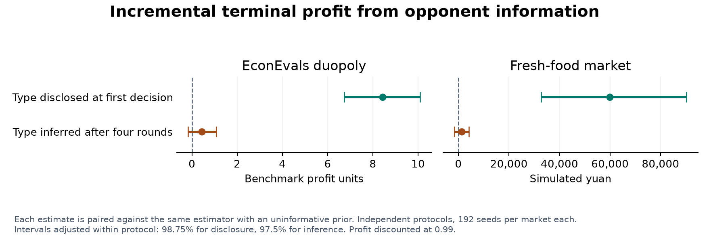

# 公开报价能让博弈建议赚到钱吗？竞争定价中对手信息、调价与弃权的配对研究

后续独立确认覆盖两份新模型权重、隐藏切换时点、原模型自主采纳与冻结后的新种子复验。企业真实利润仍待现场数据。[独立确认报告](independent-deployment.md) · [现场验证设计](field-validation.md)

**投稿判断。** 现有系统足以写一篇计算实验论文或工作论文。最清楚的贡献是把三个常被一起解释的结果分别测量出来：对手的策略在经济上有多重要、企业能从公开报价识别多少、识别后修改原计划能增加多少终局利润。系统也能把弃权的代价算出来。在有限的真实模型草稿上，收益和低损失风险尚未得到确认。以改善真实企业利润为主张的论文仍缺独立的现场证据。

### 最终报告的四个研究问题

| 研究问题 | 当前可以回答到哪里 | 应当显示的主指标 |
|---|---|---|
| RQ1 同一个企业、同一份草稿，只看公开报价再建议调价，平均能否比保留原计划赚得更多？ | 指定模拟市场与规则草稿可以完整比较；两家真实模型生成草稿的证据仍有限，未确认可迁移优势。 | 含弃权在内的全机会终局利润差，与保留、固定涨跌、直接公开价值模型和等计算量先验比较。 |
| RQ2 对手信息本身值多少钱？实际报价能否提供这部分价值？ | 同历史配对能识别给定实验分布、干预期限和报价集合下的差异。完全披露对手类型提高两个市场的可执行收益；观察一个报价周期后的分类改善只转化为很小且不确定的增量。 | 同历史最优动作冲突数、两种信息条件下的利润上界差、同一价值模型使用不同信息时的配对利润差。 |
| RQ3 建议器能否在事前判断哪些调价该放弃？ | 能测出筛选在部分规则样本中具有平均价值；放行损失率和错过盈利机会仍然很高，既定 10% 损失风险标准未通过。 | 覆盖率、放行后亏损、被拒候选本可获利、相对同覆盖率随机放行的金额，均以完整机会为基础。 |
| RQ4 换草稿来源、信息权限、对手家族或利润口径后，结果还能否维持？ | 已覆盖两市场、规则与两家 LLM 草稿、一个未见过的在线学习对手及未折现敏感性。原生 v20.1 对规则草稿的 .95 折现优势有两批证据；相对固定涨价及未折现复验的优势未确认。 | 每种分布独立列结果、行动分歧和区间，并说明一次干预与反复部署的区别。 |

### 可以怎样写摘要

我们研究企业已形成报价时，依据公开历史给出的策略建议能否提高该企业的终局利润。我们在两个竞争市场中复制相同决策状态，分别执行原报价和两个替代报价，把被拒候选也结算到终局。在每市场 192 个未见种子的受控实验中，准确披露对手即将采用的策略，可使同一价值模型相对忽略类型的决策分别多赚 8.42 个基准利润单位和 59,934 模拟元。在另一批独立种子上，企业先观察一个报价周期再预测类型，尽管预测优于均匀猜测，使用这一预测的配对利润增量区间在两市场均包含零。部分策略的选择性干预提高了平均收益，但仍放行了大量最终亏损的调价。结果限定了对手建模在有限信息下能够带来的决策价值，并给出区分“信息有价值”“信息可识别”和“建议可获利”的可复现实验。

### 如何讲与文献的区别

1. **比较的起点是已经存在的一份经营草稿。** EconEvals 有动态定价和双寡头任务。其经营成绩或竞争价格刻画的是另一种结果。本研究在实际草稿上作一次可撤回的相对修改，问同一企业因此多赚多少钱。在模型谈判已有正结果的背景下，定价中对手在本轮看不到尚未结算的报价，收益取决于之后的响应。[EconEvals](https://arxiv.org/html/2503.18825v4) · [重复谈判中的对手模拟](https://arxiv.org/html/2602.19309v2)
2. **建议、采纳、选择性委托均有直接先例。** Karlinsky-Shichor 与 Netzer 在 B2B 铝材田野实验中发现，收到算法建议的报价利润较对照高 11%，并另用反事实分析选择应由人或机器定价的场景。Hillenbrand 等也已在竞争定价实验中让参与者获得 LLM 建议。本项目的优势是能同时知道每个模拟机会“保留会怎样、采纳会怎样、拒绝的替代会怎样”；现场研究的优势是能观察真人采纳与真实成交。两种证据可以并存。[B2B 定价田野实验](https://doi.org/10.1287/mksc.2023.1449) · [竞争定价与 LLM 建议实验](https://arxiv.org/abs/2609.26861) · [序列建议与弃权](https://proceedings.iclr.cc/paper_files/paper/2024/hash/6cda6dae05ae5e42ea78be85d5a26f77-Abstract-Conference.html)
3. **本文的贡献是可被反驳的经验分解。** 让对手响应反事实行为、比较有无信息的最优决策，分别已有策略遗憾与信息价值研究。可声称的是，本研究在同一经济结算中比较了固定对手原报价路径、随改价而响应的对手、准确披露类型、从历史推断类型，并用同预算及同覆盖率对照测量可兑现利润。研究结论是对正向文献适用条件的补充。对完全同构方案的定向检索不足以支持“首次”主张。[策略遗憾](https://arxiv.org/abs/1206.6400) · [信息价值](https://doi.org/10.1287/opre.18.5.947) · [最接近的研究与检索范围](publication-related-work.md)

### 新实验一：相同历史，不同对手

外部市场使用固定版本 EconEvals 的需求和利润结算。生鲜保留价格约束、履约、缺货和退出。每市场分别用 128 个训练、64 个校准、192 个留出种子。企业在预定时点拿到同一份草稿，评估者复制市场；从下一次结算起，对手进入跟随/压价或反向反应，两种世界等权。两世界的当前首轮结算逐项一致。每种世界分别原价、下调 4%、上调 4%，四轮后各自依据真实历史继续到第 60 轮。训练标签可使用已结束模拟的利润；建议输入只能使用双方历史报价、草稿和轮次。受控披露组另有一个可能报错的类型信号，信号错误与种子独立。

| 留出结果，各市场 192 个新种子 | EconEvals，基准利润单位 | 生鲜，模拟元 |
|---|---:|---:|
| 两种对手下最优动作集合没有交集 | 154 / 192 | 130 / 192 |
| 至少有一个相同替代报价的收益在两世界反号 | 166 / 192 | 141 / 192 |
| 完美类型信息带来的两种事后上界之差 | +6.94 [5.78, 8.20] | +49,221 [38,039, 61,720] |
| 同一可执行模型获知真类型，相对只用等概率先验 | **+8.42 [6.73, 10.09]** | **+59,934 [32,708, 90,236]** |
| 模型相对保留草稿，信号准确率从 50%、75% 到 100% | +6.60、+7.98、+15.02 | −2,435、+19,234、+57,499 |

方括号为 98.75% 种子配对自举区间，四项主要比较按 Bonferroni 分配家族 5% 的名义错误水平。主终点是 .99 折现至终局的企业利润差；不折现时，模型获知真类型的配对增量分别为 +8.84 和 +68,650。两种信息上界都给评估者本种子的完整收益表；第一种只能在两个世界用同一动作，第二种可以按类型选动作。二者之差仅衡量种子内完美类型信息的事后价值。实际模型会有估计误差，模型之间的增量可以超过两种上界之差，同时各自的实际收益仍不超过相应上界。对手在起点后才换策略是实验设定，最优动作冲突比例不能解释为真实市场发生率。[预定设计](../experiment-specs/publication-v1/PLAN.md) · [主结果及敏感性](../experiment-results/publication-v1/results.json)

### 新实验二：只能从报价历史推断时，增量去了哪里？

另取每市场 192 个新种子，每个种子结算稳定、需求变动、对手跟随/压价、对手反向四种环境。企业先按原草稿完成四轮，再用已公布的报价更新四种类型的概率。各组使用相同预测表、候选和计算；直接价值模型无需先判断类型。研究者知道在哪个报价窗口检验，经营者看不到是否发生变化和真标签。下表的利润比较均来自新分布，不能从两批实验的均值相减推断等待四轮的市场成本。[延迟检验](../experiment-specs/publication-v1/DELAY.md)

| 四轮后能够做到什么 | EconEvals | 生鲜 |
|---|---:|---:|
| 识别四种类型的准确率，均匀猜测为 25% | 45.6% | 67.7% |
| 多分类 Brier 分数，均匀先验为 0.75，越低越好 | 0.613 | 0.409 |
| 草稿也不交给分类器时，仅从已公布报价得到的准确率 | 43.9% | 68.2% |
| 纯需求和稳定场景中错报为对手变化 | 50.8% | 9.4% |
| 使用类型预测相对使用均匀先验的终局利润增量 | **+0.43 [−0.16, +1.07]** | **+1,249 [−1,546, +4,175]** |
| 使用类型预测相对直接公开价值模型 | +0.26 [−0.30, +0.80] | +247 [−4,224, +4,829] |
| 768 个机会中，类型预测实际改变了多少个动作 | 118 | 26 |

利润区间为 97.5% 种子簇自举区间，前一行“相对均匀先验”是两市场预定的主要比较，其余为诊断。推断型建议相对保留草稿分别是 +2.70 和 +53,603，直接公开价值模型也分别是 +2.44 和 +53,356。生鲜的分类质量较高，三选一动作却很少改变。外部市场中，稳定和纯需求变化在全部 192 对四轮合同上产生了完全相同的历史报价；剥离当期草稿后，分类器在每一对上的概率向量也完全一致。该检查识别了报价中缺失的需求信息，说明为什么应当把经营草稿可能携带的内部反馈和真正的公开报价分开。[逐项结果与混淆矩阵](../experiment-results/publication-v1/delayed-results.json) · [仅报价消融](../experiment-specs/publication-v1/DRAFT-ABLATION.md)

**弃权有经济价值，低损失保证仍未通过。** 对四轮后推断型建议实际拒绝的机会，再结算其得分最高的调价方向。外部放行 421 个，其中 175 个终局亏损；拒绝 347 个，其中 146 个本可获利。生鲜分别是放行 572 个、亏损 243 个，拒绝 196 个、错过 94 个赢家。相对同覆盖率随机放行同一候选，策略平均多赚 1.83 [1.11, 2.54] 和 15,437 [6,855, 24,202]。但放行亏损率约为 41.6% 和 42.5%，按种子聚类计算的单侧自举上界为 45.7% 和 46.3%。这项诊断表明，筛选器可以提高期望收益，同时不适合以低亏损概率为目标的企业。[弃权核验](../experiment-results/publication-v1/selection.json)

### 换成模型草稿和学习型对手

- **原冻结建议器的跨草稿检验。** 在真实模型已生成且三条路径齐全的 80 个外部机会（40 个种子、两家模型）上，回顾性重算相对保留为 −1.20 [−7.28, +4.55]；相对无条件建模为 +0.18 [−1.16, +1.51]。49 个放行中 26 个亏损。另以 8 个全新生鲜种子让两家真实模型从开局报价到终局，原冻结建议器只放行 1 次且该次亏损，7 次弃权里有 6 个被拒候选本可获利；条件与无条件版本的方向及实际收益一致。两组的种子和市场分开计算。前一组既有轨迹曾用于别的问题，后一组才是新增付费前瞻检验。[真实样本分析](../experiment-results/publication-v1/results.json)
- **新推断模型的迁移。** 用新模型评估同一批真实草稿，外部相对保留为 +2.07 [−2.63, +6.21]，生鲜为 +1,696 [−63,131, +73,988]。此时点没有像训练协议那样对齐一次策略切换。这是策略冻结后的数据复用，不能与前瞻证据合并。这里的“真实模型”指实际调用了商业 LLM；市场和利润仍来自模拟器。[迁移结果](../experiment-results/publication-v1/delayed-results.json)
- **未见过的学习对手。** 加入从每轮自身已实现利润学习九种价格的 Exp3，对照为相同价格网格与随机数、权重永远均匀的对手。两组各 192 个新种子。学习组 192 个种子的终局报价概率都会随焦点企业改价改变，其中 25 个种子的实际报价路径也改变；均匀组为零。冻结的推断建议器在 Exp3 组相对保留为 −0.65 [−4.45, +3.29]，且 192 次均与均匀类型先验模型选了相同的动作。跨对手检验覆盖了一类确实学习的对手，尚未覆盖多种深度强化学习或真实经营者。[学习对手设计](../experiment-specs/publication-v1/UNSEEN.md) · [实验结果](../experiment-results/publication-v1/unseen.json) · [Exp3 原始论文](https://doi.org/10.1137/S0097539701398375)

### 如果目标是正式发表，优先补什么？

| 优先程度 | 目前缺口 | 可以验收的补证 |
|---|---|---|
| 最高，决定能否主张真实模型受益 | 真实模型前瞻样本太少，且罕见大损益使生鲜均值不稳定。旧外部数据是回顾性复用。 | 预先定义最小有实际意义的利润增量与可承受的损失（频率和金额）；按种子配对、分模型与冲击类型分层，在不参与调参的新模型版本和独立批次封存决定。报告样本流、失败回退、重复请求及未折现终局。 |
| 高，决定“对手模型”能否单独成为论文贡献 | 当前正优势能被直接价值学习或固定调价解释；公开提示的强度和发现时点由实验者设置。 | 在完全未知切换时点与跳变频率的环境中，加入能自主选择学习/等待的对手、非四类混合策略和额外独立市场；同种子保持信息、候选和搜索成本一致。此次已补一类未见的 Exp3 及负对照。 |
| 高，决定“何时弃权”能否推广 | 平均选择价值为正与放行风险低对应不同目标。当前多数真实机会无法满足低风险验收。 | 固定业务效用和风险门槛后再做独立校准；同时报告覆盖率、漏掉收益、少数大额损失、完整风险–覆盖曲线及样本外风险上界。 |
| 依投稿主张而定 | 模拟器可以观测全部反事实；现实企业自主采纳、竞争者长期适应和外部有效性尚未验证。 | 方法论文可以用公开模拟、匿名代码和第三方复跑支持；若主张实际商业效果，需要公司层面随机建议、合适的干扰/溢出设计和真实利润数据。若声称提供建议本身有效，还要区分建议被展示、被采纳及实际执行。 |

**样本量需要在了解经济量级后决定。** 例如把外部市场每个机会 +5 个利润单位设为有意义的效果，按历史 40 个种子配对差的试点标准差 19.29、双侧 5% 和 80% 功效，正态近似约需 117 个独立种子。它只是说明如何规划，阈值尚未由实际业务确认。生鲜原 12 个真实种子与新增 8 个种子，配对差标准差分别约为 43.2 万和 1.7 万模拟元；后批只有一次干预。直接用后一批外推所需样本会严重低估不确定性。不宜为了得到显著结果继续挑选种子。

### 验收与复现

主要设计和追加实验的顺序、四项和两项主要比较及校正区间均已保存。这里的“冻结”指在读取对应留出结果前锁定本地方案、模型或决策；尚无第三方公开时间戳的正式预注册。每种模拟把同种子的对手类型、候选报价和供应商重复观测聚为一个独立单位；未把终局多个轮次算作独立观测。除各协议指定的主要比较外，其他区间均作诊断解释。上界试验、类型推断试验使用不同种子和机制分布，图中两行分别与各自先验对照。Exp3 运行时验收发现上游边际利润以报价除以价格敏感系数后扣成本，已按作者结算单位修正价格下界和奖励归一化，再运行完整矩阵。

只重算论文主要区间需要 Python 3 和 NumPy。新机器可运行 `python scripts/publication/verify.py`。完整实验另需项目的研究环境（Python 3.12、scikit-learn 1.8.0、SciPy、joblib 及已固定的 EconEvals 上游检出）；`python scripts/publication/verify.py --replay` 还会抽选两端种子重建市场，并重放 8 个新增真实机会的全部 24 条路径。代码、训练/校准/留出利润路径、公开历史、模型权重、主表和图都归档在仓库。可按 paired.py 的 train/cal、signal_policy.py、paired.py test、publication_stats.py 的顺序复原第一项实验；延迟实验依次运行 delayed.py 的 train/fit/test 和 delayed_analysis.py report。需重做真实模型采集时，原授权总预算仍是上限。仅离线检验不产生模型费用。

本轮新增 220 次有效商业模型调用，无失败与回退。预算账增量 0.515500 元，累计 49.844916 / 50 元，余额 0.155084 元，尚未与供应商账单对账。[复现说明与数据字典](../experiment-specs/publication-v1/REPRODUCE.md) · [预算](../experiment-results/publication-v1/budget.json) · [完整文献对照](publication-related-work.md) · [上阶段真实草稿与原生经营建议](public-price-value-stage.md)
