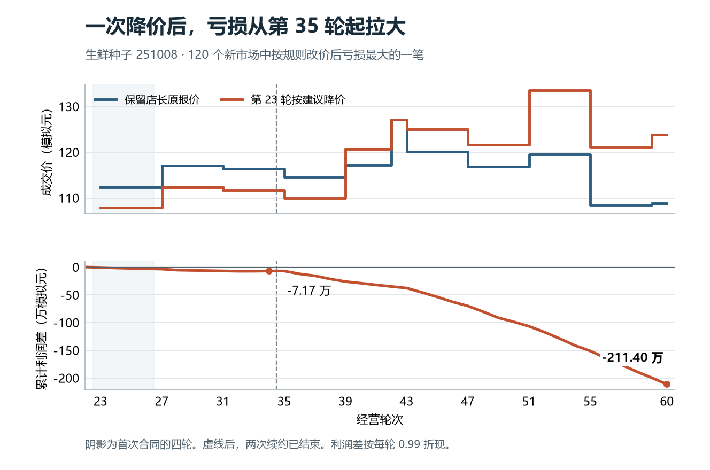

# 调价之后，能否预判店长自己的下一步

**零售能重复测到增收，低风险自动改价仍未过线。** 在 360 个额外零售市场里，每次机会平均多赚 10.26 个基准利润单位，81 次实际改价有 77 次赚、4 次亏。风险上界 13.3%，原定上限 10%。

预测本店两次续约优于假设调价没有后效。简单记住历史市场的平均后效，和模型预报的误差相差很小，八组配对差异的区间均跨零。给定相同搜索和模型预算，在生鲜比直接估值每机会多赚 3.64 万模拟元，在零售少赚 18.32 个利润单位。两种方法降低或提高出手频率的程度不同，固定推荐数量后，两市的增量区间都跨零。

**本次能做的是在改价前列出风险、事后用配对终局核实。** 生鲜的模型能在 29 个应该保留原计划的机会中提前挡住 8 个，同时放过最差的 211.40 万模拟元损失。系统继续保留店长原报价。

## 独立零售确认与后期亏损否决

第一批零售实际改价 35 次亏 3 次，利润和覆盖过线，有限样本的亏损率上界仍达 25.26%。因此单独冻结 360 个全新零售市场，逐局在当轮结算前写下处理决定，用真实模型将保持和执行两条路径结算到底。规则、权重和 0.10 分数截点均沿用原版本。

这 360 次机会平均相对草稿 **+10.26 [+7.50, +13.26]** 个利润单位。实际改价 81 次（22.5%），其中 **4 次亏损（4.9%）**，亏损率上界 **13.3%**，最差 -35.90。按原三条线的本批结论为**未通过**。其中 3 笔终局亏损在前四轮还领先，1 笔在前十二轮还领先。3/4 笔超过半数亏损发生在这之后。两批结果分开报告。

### 预警晚期损失能否少错几个

主批发现晚亏后，在上述扩样批中另留 288 个当时尚未开始的市场。额外评分只用公开信息。对于原本要改的价格，预估后期亏损金额太大就弃权。阈值只取自 27 个历史拟放行机会，两个金额模型均以历史上评分最高的四分之一为参照。另一个同预算模型直接预估全部终局损失金额。288 个市场每局同时保存两者意见，主规则的原草稿与执行两种真实结算均已采集，因而可以逐例核算每次取消的盈亏。以下金额是每个预定机会的终局利润差，最后两列是被取消交易的金额总计。

| 规则 | 相对草稿的利润与区间 | 改价 / 亏损 | 风险上界 | 相对原建议的配对差 | 避免亏损 | 错过盈利 |
|---|---:|---:|---:|---:|---:|---:|
| 原建议 | +9.22 [+6.15, +12.43] | 58 / 3 | 15.8% | +0.00 [+0.00, +0.00] | 0.00 | 0.00 |
| 按晚期损失金额否决 | +6.01 [+3.66, +8.66] | 43 / 3 | 20.9% | -3.21 [-5.60, -1.31] | 0.00 | 924.87 |
| 按总损失金额否决 | +7.92 [+5.18, +10.96] | 52 / 3 | 17.6% | -1.30 [-3.03, -0.20] | 0.00 | 374.38 |
| 随机取消四分之一 | +7.92 [+5.10, +11.09] | 48 / 2 | 15.9% | -1.30 [-2.57, -0.34] | 3.87 | 377.26 |

晚期否决实际取消 15 次，其中 0 次本会亏钱，15 次本会赚钱。晚期否决相对于直接估计总损失的增量为 -1.91 [-3.79, -0.54]。强制两者都取消 15 次后，增量为 +0.28 [-1.01, +1.85]。晚期否决在这批的联合验收为**未通过**。

## 怎么比较

每个新市场有四家店。商店用本地真实 SmolLM2 模型从九档调价动作抽样，三组人格分别为相同性格、上一阶段留出过的人格、随机混合人格。本轮测试种子全部是新的，这三组人格设计沿用上一阶段。生鲜保留缺货、限价和退出约束。每局提前抽一家店和一次调价机会。保持草稿、降 4%、涨 4% 各自运行至第 60 轮。第一份调价合同持续四轮，之后店长按实际看到的销量和利润自主续约。

公开预测器看到决策时间、焦点店的草稿、此前最多四家的挂牌价格和是否挂牌。模型和对手的人格、市场种子、库存、各自利润和未公开报价均不输入。相同市场和同一草稿下，两个主要方法都评估三种选择，使用同样数量、大小和层数的树模型。每种方法每市场训练 576 棵树（含四折拟合及全量重估），单次评分各遍历 192 棵。给出建议无需额外调用经营模型。一个先预测本店两次续约的报价和在营状态差异，另一个直接预测利润和亏损。两种方法的打分都用预计净收益减预计亏损金额。超过利润门槛且亏损风险分数足够低才提出改价。表中另列固定降价、只拟合一层的简单估值和保留原计划作参照。

主协议在生成测试市场前提交（a078a46）。估值代码和历史阈值在新终局结果揭盲前提交（f2aa197）。此时后台已有少数原始市场写盘。主批按公共前缀单独封存决定后才打开三臂收益计分。独立精度批将同一公开规则直接放进模拟报价回路。

拟合沿用上一阶段每市 216 个种子，历史校准另用每市 96 个。调价后亏损上界、覆盖率和利润门槛沿用原约定。真实拍板要求利润区间下端超过生鲜 2 万模拟元或零售 5 单位、至少 10% 机会实际改到成交价、已改价机会亏损率的单侧 98.75% 上界至多 10%。零失误也需至少 42 次有效调价才能达到风险门槛。1、2、3 次亏损则至少要 62、79、94 次有效调价。历史校准用于选阈值，所以最终判断另看新确认，两个阶段分别列示。

所有区间用市场种子配对自举，取 1.25% 和 98.75% 分位。亏损用精确二项上界。收益是从机会当轮起按 0.99 折现至终局、相对于店长原草稿的增量。实际改价按首份四轮合同内至少一轮执行价格与草稿路径不同来判断，缺货和零销量照常结算。退出和限价导致落价相同也计入全部机会的平均收益。一次干预的结果不能推算为四店持续安装的收益。

## 新市场主结果

### 生鲜

利润单位为万模拟元。每行以全部 120 次机会为分母。

| 方法 | 相对草稿的平均终局收益与区间 | 实际改价 | 其中亏损 | 亏损率上界 | 单笔最差 |
|---|---:|---:|---:|---:|---:|
| 保留店长原计划 | 0.00 [0.00, 0.00] | 0 | 0 | — | 0.00 |
| 有公开竞争就降 4% | 17.92 [6.98, 28.44] | 100 | 33 | 44.5% | -211.40 |
| 直接用公开报价估值 | 16.72 [7.10, 26.82] | 73 | 21 | 42.2% | -188.65 |
| 同预算直接估值 | 11.78 [1.85, 21.79] | 58 | 16 | 42.8% | -211.40 |
| 先预测本店两次续约 | 15.42 [4.65, 26.14] | 75 | 23 | 44.0% | -211.40 |
| 事后告知本店续约轨迹 | 14.62 [8.09, 21.89] | 45 | 6 | 28.8% | -35.02 |

续约模型相对于同预算直接估值的配对增量为 3.64 [0.27, 8.10]。相对于固定降价为 -2.50 [-5.46, 0.03]。拒绝了 38 次。如果全部改成降价，其中 10 次本会亏损，15 次本会盈利。

固定放行数量的附加检验中，每种方法都从 107 次可决策机会中选 27 次降价。续约模型、同预算直接估值、单层估值及随机排序的实际亏损／生效调价依次为 7/22、7/24、5/23、10/26。续约模型相对同预算模型的配对利润差为 -2.32 [-7.03, 2.14]。

### 零售

利润单位为零售基准利润单位。每行以全部 120 次机会为分母。

| 方法 | 相对草稿的平均终局收益与区间 | 实际改价 | 其中亏损 | 亏损率上界 | 单笔最差 |
|---|---:|---:|---:|---:|---:|
| 保留店长原计划 | 0.00 [0.00, 0.00] | 0 | 0 | — | 0.00 |
| 有公开竞争就降 4% | 33.80 [22.40, 45.53] | 120 | 26 | 31.3% | -80.67 |
| 直接用公开报价估值 | 13.17 [7.88, 18.75] | 48 | 6 | 27.1% | -49.87 |
| 同预算直接估值 | 28.88 [19.59, 38.69] | 92 | 15 | 26.8% | -80.67 |
| 先预测本店两次续约 | 10.56 [6.02, 15.50] | 35 | 3 | 25.3% | -49.87 |
| 事后告知本店续约轨迹 | 34.67 [24.68, 45.77] | 88 | 6 | 15.4% | -80.67 |

续约模型相对于同预算直接估值的配对增量为 -18.32 [-28.26, -9.51]。相对于固定降价为 -23.23 [-34.95, -12.48]。拒绝了 85 次。如果全部改成降价，其中 23 次本会亏损，62 次本会盈利。

固定放行数量的附加检验中，每种方法都从 120 次可决策机会中选 30 次降价。续约模型、同预算直接估值、单层估值及随机排序的实际亏损／生效调价依次为 2/30、3/30、2/30、6/30。续约模型相对同预算模型的配对利润差为 1.23 [-0.37, 3.31]。

### 两次续约究竟能不能预测

仅对涨降分支与保持分支都在营的店计算本店申请报价误差。表中是平均绝对对数误差乘 100，越小越好。预测目标是同一个市场两条路径的差。

| 市场 | 动作与续约 | 双方在营样本 | 预测没有差异 | 训练集平均差 | 公开报价预测 | 预测相对零差异的配对误差与区间 |
|---|---|---:|---:|---:|---:|---:|
| 生鲜 | 降价后第1次 | 103 | 5.05 | 2.96 | 2.81 | -2.24 [-2.73, -1.68] |
| 生鲜 | 降价后第2次 | 97 | 5.06 | 3.57 | 3.54 | -1.51 [-2.02, -0.97] |
| 生鲜 | 涨价后第1次 | 102 | 4.69 | 2.92 | 2.78 | -1.91 [-2.43, -1.36] |
| 生鲜 | 涨价后第2次 | 97 | 4.90 | 3.65 | 3.70 | -1.20 [-1.85, -0.51] |
| 零售 | 降价后第1次 | 120 | 4.82 | 2.91 | 2.84 | -1.98 [-2.51, -1.44] |
| 零售 | 降价后第2次 | 120 | 4.82 | 3.01 | 3.09 | -1.73 [-2.28, -1.16] |
| 零售 | 涨价后第1次 | 120 | 4.19 | 2.12 | 2.19 | -2.00 [-2.53, -1.43] |
| 零售 | 涨价后第2次 | 120 | 4.51 | 2.51 | 2.49 | -2.01 [-2.50, -1.48] |

### 只改变本店将来抽到哪一个报价动作

每市场预抽 12 局，每局四种本店后续抽样。分母是确实改到成交价的独立市场数。盈亏翻转要求同一市场既出现严格正收益，也出现严格负收益。

| 市场 | 初次选择 | 有效市场 | 四次抽样中盈亏翻转 | 最好与最差抽样间的平均差距和区间 |
|---|---|---:|---:|---:|
| 生鲜 | 降价 | 10 | 4 | 66.25 [37.82, 95.83] |
| 生鲜 | 涨价 | 10 | 3 | 73.43 [26.15, 141.61] |
| 零售 | 降价 | 12 | 4 | 49.44 [33.45, 67.45] |
| 零售 | 涨价 | 12 | 1 | 44.31 [24.68, 70.87] |

## 同样的风险分数线是否挑得更准

两种模型各用自己在历史批冻结的分数线时，生鲜续约模型比同预算直接估值多改了 17 次，零售少改了 57 次。改用同一风险分数线，零售两者都取 0.10 时，续约模型多赚 3.71 [0.85, 7.05]。两者都取 0.30 时差额 −1.11 [−8.04, 5.66]。生鲜用两条相同分数线作对照的利润差区间均跨零。不同模型的分数未必同样准确，相同分数线仍可能产生不同出手次数。上表另给出了恰好选相同数量的降价机会时的对照结果。

三组人格的每市场样本各为 40 个，每个席位恰好 30 次。生鲜普通、前阶段留出、随机混合三组实际改价后分别亏 10/29、6/26、7/20 次。零售分别亏 0/8、1/14、2/13 次。单组零失误的 8 次不足以验证 10% 风险上界。

## 少数大亏是怎样累积的

生鲜最差放行发生在种子 251008 的第 23 轮。这家店和草稿对照店都活到了第 60 轮。前四轮少赚 3.10 万，后面八轮又少赚 4.07 万，第 35 轮以后少赚 204.23 万，总计少赚 211.40 万模拟元。204.23 万按发生时段计，包含其间同行、销量与本店经营反馈的共同影响。第 47–50 轮，改过价的店卖出 7,080 单，保留原草稿的同店卖出 16,999 单。最初两次续约，申请报价差约为 −4%，模型估计为 −3.2% 和 −2.9%。近两次报价方向估对了，远期利润仍可能大亏。23 次生鲜亏损中有 16 次超过半数损失发生在头 12 轮之后，6 次在头 12 轮还领先。零售主确认的 3 次亏损在头 12 轮也都仍领先。

生鲜历史校准没有找到满足三条线的方案。作为研究候选，按预注册后备选择规则冻结的风险分数截点是 0.40，零售是 0.10。真实部署的亏损上界要求始终是 0.10。事后敏感性检查把生鲜分数也卡在 0.10，结果只改价 11/120 次，仍亏 4 次，平均多赚 358 模拟元，最差少赚 31.02 万。预测出来的概率不能直接当作真实保障。

## 到底认出了几次应该弃权

“该保留”按同一个种子的三个完整终局判定，涨价和降价都没有比保持更赚钱。只统计焦点店当时有公开竞争、且至少一个方向能真的改到执行价的机会。生鲜 103 个这样的机会里，应该保留的有 29 个。建议器弃权 25 次，认对 8 次，同时错过 17 个存在盈利改价的机会。零售 120 个里应该保留 24 个，弃权 85 次，认对 21 次，同时错过 64 个盈利机会。仅报挡住了多少次，会掩盖过度弃权付出的代价。

单个终局也会受经营模型抽样影响。给同一开局重新抽三次本店以后的报价，把原结果一并保留，每次对所有候选共用该抽样序列。10 个生鲜有效市场里有 2 个、12 个零售市场里有 4 个，在四次续局中的“该不该保持”答案发生翻转。各市恰有 5 个预抽市场被模型实际放行，这小组里已选动作没有观察到盈亏翻转。全部 24 个市场都是预抽，同一个市场的四次后续抽样没有被当作四个独立种子。

## 只给店长自己的账本，会怎样

额外给研究估值器本店前两份合同的销量和利润，其他设置保持一致。生鲜相对只看公开信息每次机会多赚 2.73 万 [0.34, 7.82]，74 次改价中 19 次亏损。零售多赚 18.16 [9.64, 28.25]，90 次中 14 次亏损。账本能改变利润估值和出手频率，仍未通过原风险线。该信息只进入诊断组。事后知道保留与干预两条路径的两次真实续约和在营状态，也能改善两市场的亏损概率评分。两条潜在路径无法在真实报价前同时观察。

## 验收决定与下一条主线

保留公开预检和原报价的默认执行权。零售规则两次测得正的平均终局收益，扩样风险上界从首批的 25.26% 收窄到 13.31%，距离部署要求还有 3.31 个百分点。生鲜实际改价后的亏损率达 30.7%，即使将模型自己的风险分数卡在 0.10 也未过线。新加的后期亏损否决在 288 个前瞻机会中错过 15 笔盈利，避免 0 笔亏损，停止把这一层作为执行候选。

下一步的实现重点是为同一个公开盘面和同一份初始报价保留多条后续抽样，直接学习直到终局的利润分布。用相同模拟预算的直接估值作对照，在相同出手次数下检验是否真正少亏。零售以独立种子的亏损率上界从 13.31% 降到 10% 为目标，同时保住利润下界高于 5、实际出手覆盖至少 10%。生鲜须另外检验能否降低百万级尾部损失，继续使用每机会利润下界 2 万模拟元的原门槛。该方向的效果尚待独立验证。

## 如何预检一份报价

运行 `python scripts/four_prices/review_price.py --own-renewal experiment-specs/price-causes-v1/panel-example.json` 即可查看两个方向的预估利润、损失金额、实际改价后的亏损概率、未来两次续约的报价差异和最终处理意见。研究候选列为 `candidate`，实际处理列为 `disposition`。正式执行维持店长原计划。权重只含数值数组，读取一份报价无需启动市场、模型服务或 GPU。

## 样本、费用与证据

全部 600 个新市场按设计轮换席位。360 份独立报价意见逐局在当轮结算前落盘，288 份额外否决意见均在对应终局文件生成前落盘，当时只能读取报价前缀。569 项项目测试通过，另有一条依赖弃用提示。独立 Git 检出用固定线程离线重建了主收益、风险阈值、单例预检、抽样续局和 360 个零售市场的追加结果，受版本控制的文件无差异。全部市场完成后的项目模型进程数为零。

本阶段共 600 个全新市场种子。240 个主确认市场各结算三条终局，另外 360 个零售市场各结算两条终局。预抽的 24 个市场各添三种未来抽样，每种再结算三条终局。合计 1,656 条终局路径。主确认 15,698 份真实本地模型请求，改变未来抽样新增 1,228 份，零售扩样 20,811 份。新增商业 API 费用 0 元，原 50 元预算余 0.155084 元。本轮模拟使用真实本机 SmolLM2，一种模型、九档报价、四店与固定时长。历史拟合含前期后端配置，这批新交易全部使用 CPU。没有企业交易或真人采纳，不能给出真实企业增收幅度。

[冻结协议](../experiment-specs/renewal-risk-v1/PLAN.md) · [逐步复算](../experiment-specs/renewal-risk-v1/REPRODUCE.md) · [主确认](../experiment-results/renewal-risk-v1/confirmation.json) · [同出手次数及弃权标签](../experiment-results/renewal-risk-v1/diagnostics.json) · [只改后续抽样](../experiment-results/renewal-risk-v1/label-stability.json) · [独立零售结果](../experiment-results/renewal-risk-v1/precision-results.json) · [后期亏损否决](../experiment-results/renewal-risk-v1/late-veto-results.json) · [CPU记录](../experiment-results/renewal-risk-v1/runtime.json)
